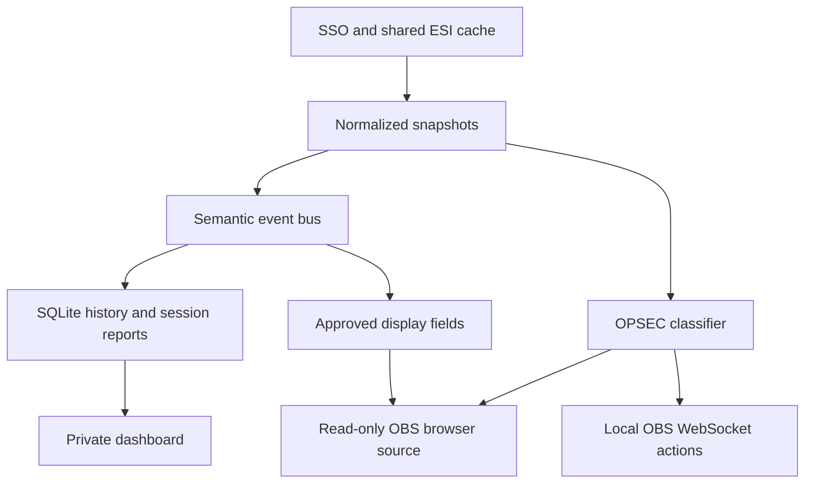

# Kairo implementation notes

## Runtime boundaries

One supervisor owns the active Node runtime child and managed dataset generations. The child owns two loopback-only HTTP servers: the dashboard listener on port 4380 serves the compiled React app and authenticated local APIs; the stream listener on 4381 serves only the transparent renderer, its style/script and sanitized stream state/events. Dataset conversion runs in a cancellable worker. The supervisor drains and stops the old runtime before starting a replacement, commits a prepared generation only after startup succeeds, and retains the previous generation if startup fails.

Shutdown first stops recurring production and new HTTP admission, then drains accepted requests, dataset and collector work while their dependencies remain available. The semantic bus owns returned listener promises, including nested events; Registry cleanup and Stream/OBS disposal finish before ESI and SQLite close. Startup failure uses the same staged ownership boundaries, preserves the original error and records any secondary cleanup failures. Unresolved accepted work reaches the supervisor's failure deadline rather than being reported as a successful handoff.



The local hot path never invokes AI. SQLite is the source of truth for local history/configuration. Browser storage holds display/workspace preferences, including pilot-specific Mapper choices and map-specific display groups, plus the stream renderer's already-sanitized layout for reconnect recovery. Tokens and authoritative map records stay in the backend.

## Source map

| Source | Responsibility |
| --- | --- |
| `server/index.mjs` | HTTP boundaries, sessions, CSRF/Origin/Host checks, APIs and startup/shutdown |
| `server/auth.mjs` | Shared discovery/key flights, PKCE/state, JWT signature/claims, per-pilot token refresh and disconnect |
| `server/vault.mjs` | AES-GCM token envelope; Windows DPAPI wrapping for the vault key |
| `server/esi.mjs` | Shared caching, request deduplication, concurrency, paced reads, pagination and limit backoff |
| `server/store.mjs` | SQLite schema/migrations, snapshots and settings |
| `server/cache-retention.mjs` | Bounded maintenance of inactive transport records and terminal market jobs |
| `server/polling.mjs` | Recommended intervals, discrete choices, descriptions, input validation and sample deadlines |
| `server/core.mjs` | Scheduling, enrichment, module orchestration and UI events |
| `server/combat.mjs` | Verified attacker participation, public-reference cache, durable combat ledger and historical backfill |
| `server/markets.mjs` | Shared hub configuration, paced scan jobs, transactional books, regional histories and paginated reports |
| `server/market-history.mjs` | Shared daily archive imports, source metadata, calendar windows and ESI-compatible summaries |
| `server/market-history-worker.mjs` | Bounded bzip2/CSV decoding and validation outside the main event loop |
| `server/market-categories.mjs` | Lazy shared default taxonomy and isolated injected catalogs |
| `server/import-math.mjs` | Pure fee, order-depth, demand, pricing, ranking and cargo calculations |
| `server/imports.mjs` | Trader authorization, cached analysis, alt-order exclusions and private saved plans |
| `components/kairo/import-analyser.tsx` | Recommendation cards, detail scenarios and import-plan workflow |
| `server/goals.mjs` | Automatic goal sources, freshness checks, type resolution and durable progress accounting |
| `server/registry.mjs` | Dynamic local module registration and lifecycle |
| `server/modules/catalog.mjs` | Built-in ESI datasets, scopes and collection intervals |
| `server/universe-history.mjs` | Fresh location/ship observations into independent activity, discovery and Session services |
| `server/discovery.mjs` | Per-pilot discovered-system membership without a lifetime movement log |
| `server/session-travel.mjs` | Session-owned movement capture and bounded reads with legacy compatibility |
| `server/modules/milestones.mjs` | Skill/job state transitions into milestone events |
| `server/projections.mjs` | Record-specific widget projections, shared per-update inputs and typed toast context |
| `server/history.mjs` | Named sessions, sample capture, event boundaries and report aggregation |
| `server/session-event-window.mjs` | Shared report/replay event membership and boundary ownership |
| `server/public-feed-transport.mjs` | Core-owned R2Z2 request sharing, pacing and bounded raw packet reuse |
| `server/places.mjs` | Universe coordinates, cold legacy Journey adapters and private entity annotations |
| `server/universe-jspace.mjs` | Private Maps commands, compact library summaries and selected-map projection |
| `server/sse.mjs` | Shared ordered event writes, backpressure and bounded slow-client shutdown |
| `server/obs.mjs` | OBS v5 authentication, local connection, inventory and state action execution |
| `server/opsec.mjs` | Space classification, source precedence and bounded continuity |
| `public/stream/protection.js` | Shared state keys, labels and legacy OBS rule normalization |
| `server/stream.mjs` | Stream configuration validation, explicit projection, toast rules and output state |
| `components/kairo/` | Dashboard shell, operations views, local intelligence tools, Connections and Stream Studio |
| `public/stream/` | Small independent renderer without the dashboard application or private API access |

## Event contract

Data updates publish `{type: 'data.<dataset>', characterId, payload: {current, previous}}`; fresh location/ship events also carry an internal receipt-time observation for Session ownership. Only fresh successful data emits these events. Modules publish semantic events through `ctx.publish()`; core persists them once when a deduplication key is supplied and fans them out to subscribers.

A module observes data through the shared service rather than adding its own ESI client. Semantic events are deliberately separate from stream notifications. Saved toast templates may interpolate only event-specific allowlisted display fields in `server/projections.mjs`. Raw payloads and credentials never enter stream output. Location tokens are evaluated against the current OPSEC state, including delayed and active toasts. Literal existing templates remain valid.

## Add a local module

Add an `.mjs` file under `server/modules/` with a default export. It is discovered at process startup.

```js
export default {
  id: 'system-counter',
  name: 'System counter',
  version: '1.0.0',
  description: 'Counts observed system entries.',
  scopes: [],
  datasets: [],
  page: { title: 'System counter' },
  migrate(db) {
    db.exec('CREATE TABLE system_counter(character_id INTEGER PRIMARY KEY, count INTEGER NOT NULL)');
  },
  register(ctx) {
    return ctx.on('location.changed', event => {
      ctx.db.prepare(`INSERT INTO system_counter VALUES(?,1)
        ON CONFLICT(character_id) DO UPDATE SET count=count+1`).run(event.characterId);
      // Optional ctx.publish({ type, characterId, summary, payload, dedupe }).
    });
  },
  read({db, characterId}) {
    const row = db.prepare('SELECT count FROM system_counter WHERE character_id=?').get(characterId);
    return {
      title: 'Observed system entries',
      columns: [{key:'count', label:'Entries'}],
      rows: [{count: row?.count || 0}],
    };
  },
};
```

The registry versions module migrations, provides namespaced key/value helpers, tracks subscriptions and calls cleanup on disable/shutdown. Enabled module pages appear automatically under Extensions and are served through the private API. Module files are trusted local code: do not install code you do not trust.

The example should add its own tables and page without editing Session travel or other unrelated modules. New built-in data collectors can be added to the dataset catalog using the shared request service. New bespoke visual widgets or new types of public stream projection require a deliberate UI/output extension; this release does not execute arbitrary module HTML in OBS.

## API groups

All dashboard API routes require a local session established by opening `/`. State-changing requests also require `X-Kairo-CSRF` from `/api/bootstrap` and the dashboard's origin.

- `/api/bootstrap`, `/api/state?character=<id>`, `/api/events`
- `/api/auth/start`, `/auth/eve/callback`, `/api/characters/<id>`
- `/api/settings`, `/api/settings/polling`, `/api/modules`, `/api/sync`
- `/api/timeline`, `/api/journey`, `/api/journey/enrich`, `/api/session`, `/api/sessions`, `/api/sessions/<id>`, `/api/export`
- `/api/markets`, `/api/markets/hubs`, `/api/markets/defaults`, `/api/markets/discover`, `/api/markets/scan`, `/api/markets/cancel`, `/api/markets/quick`, `/api/markets/browse`, `/api/markets/item`, `/api/markets/report`, `/api/markets/type`
- `/api/goals`, `/api/goals/sources`, `/api/goals/type`, `/api/notes`, item routes for update/delete
- `/api/journey/connections/<to-visit-id>?character=<id>` for legacy-only visibility compatibility
- `/api/universe/search`, `/api/universe/route`, `/api/places`, `/api/places/<kind>/<id>`
- `/api/universe/jspace`, `/api/universe/jspace/summaries`, `/api/universe/jspace/search`, `/api/universe/jspace/maps/<id>`
- `/api/stream`, `/api/stream/sources`, `/api/stream/preview`, `/api/stream/test`, `/api/opsec`
- `/api/obs`, `/api/obs/targets`, `/api/obs/filters`, `/api/obs/reconnect`, `/api/obs/apply`
- `/api/modules/<module-id>` for dynamically registered private module pages

The stream origin implements only `GET /state`, `GET /events`, the renderer routes and its allowlisted renderer script and two stylesheets. POST/PUT/DELETE are rejected there. It does not receive dashboard sessions through an application bootstrap and does not implement the private routes.

## Design choices

The UI is a dense instrument workspace with rectangular surfaces, restrained accents and consistent studio/toast styling. ESI loading never blocks navigating to another module. Explicit waiting, missing-scope, disabled, error and stale states prevent absent data being confused with live zero values. Dashboard chart points come from real wallet journal entries.

The frontend is statically exported and served by Node, avoiding a dependency install for the end user's runtime. Core, storage, OAuth and SSE use Node built-ins. Frontend source building retains the established lockfile/toolchain and optional scaffold files, but its Worker artifacts are not used by the local launcher.

## Current ownership and execution

The optimisation/refactoring checkpoint covers Kairo's existing services as well as the Universe sprint. These are in-process boundaries over the existing SQLite store, shared ESI service and event bus; modules do not introduce independent collectors for data already owned by another service.

**Travel, discovery and activity.** `discovered_systems` stores unique `(character_id, system_id)` membership and is seeded once from retained visits. Universe reads this membership directly; its ordinary state/detail/planning paths do not aggregate the lifetime visit ledger. Sessions own new movement rows through `visits.session_id`. Core captures the local fresh-response receipt time, active Session, ship and available sovereignty before asynchronous display enrichment, so a delayed name lookup cannot attach an observation to a later Session. No active Session means no new movement row. Session reports and replay use bounded indexed reads and retain old rows with no explicit Session owner. General `location.changed`/`ship.changed` activity, `/api/timeline` and approved OBS notifications remain independent.

Reports and replay share event membership through `session-event-window.mjs`. Killmail occurrence times use a half-open Session interval; other events use captured boundary cursors and explicit Session ownership. Missing observation ownership remains legacy evidence, while explicit null means unowned. Reports retain their aggregation and pagination; replay retains its fixed event cursor, suppression and limit without constructing a report.

The standalone Journey page, lifetime counters, footprint preset and visit overlay are retired. `places.mjs` keeps `/api/journey`, enrichment and hidden-link operations as cold compatibility APIs over legacy rows only; new Session-owned rows cannot enter that connection-pruning contract. Old evidence and exports remain available. Saved Universe views normalize only the retired top-level `indicator: 'visits'` to `none`, preserving other configuration keys.

**Maps.** A request-scoped read context reconciles canonical expiry once, shares operational inputs, scopes selected-map link bodies in SQLite and batches full-library reads. Reverse signature bindings are built in one edge pass. Compact summaries and search avoid projecting every map's operational payload; the selected detail API supplies the opened map. The compatible full-state endpoint remains available. The frontend coalesces overlapping invalidations into one active refresh and one retained refresh, with pilot/map ownership checks before applying results. These contexts end with the request rather than caching mutable records across requests.

Mapper display projection leaves canonical nodes, coordinates, edges, route access and expiry untouched. It uses bounded saved membership lists, keeps real boundary/anchor/protected systems, and omits collapsed interior nodes from the DOM. Camera frames update imperative surfaces; optional focus detail changes only after movement settles, using inner/outer bounds to avoid edge flicker. Node bounds, connection ports, hit testing and framing all use the displayed scale.

**Shared preparation.** Route planning prepares relevant pilot evidence and a gate graph or jump index once per request/itinerary, reusing it across legs and alternate-midpoint queries. Before accepting a plan, it checks relevant evidence, itinerary revision and used connection state again. Widget bindings share one update-local set of snapshots, settings, names, goal and Session queries while retaining record ownership and freshness rules; identical binding output does not rebroadcast unchanged state. Goals share source preparation within a refresh, preserve per-goal cutoffs and durable accounting, and publish completion only after successful SQL release. Asset enrichment resolves shared containment paths once per batch; repeated identical combat evidence does not rewrite its ledger.

Import analysis shares one current Auth roster across synchronous settings, trader and order preparation. It checks current authorization again after awaited calculation and before reusing a result; there is no retained global roster cache. Default market taxonomy consumers share a read-only facade that loads the process-selected dataset and prepares its index on first use. Injected catalogs have independent ownership. Intel abbreviation lookup stores one entry per system name in three-character buckets, preserving exact matches and ambiguity checks without materializing every prefix.

**Authentication.** Each Auth instance shares cold discovery and signing-key requests, with one-hour successful caches and the existing 12-second public-request deadline. Endpoint checks precede discovery publication, failed flights clear for retry, and an unknown signing key can force a fresh key request. JWT signature/claim validation and token refresh ownership remain per pilot; sharing public metadata does not introduce token-command retries.

**Lifecycle and transport.** Shutdown first stops new admission and scheduled work, then awaits accepted HTTP handlers (including clients that already disconnected), dataset enrichment, collectors and semantic subscribers before closing their dependencies. The bus tracks promise-returning listeners and drains work they enqueue to a fixed point; module cleanup is awaited. Failures remain visible and prevent a successful managed handoff. Market decoding owns the worker until its exit, including cancellation. ESI retains the shared four-slot limiter, caching, deduplication, priority, pagination and cooldown rules. Closing ESI rejects new callers while draining already accepted request chains; read retry policy does not replay commands after an uncertain failure.

Market courtesy pacing is owned by ESI. Fresh cache hits and active shared reads are checked before waiting, then checked again before dispatch. Waiting holds neither a network slot nor a shared flight; Market cancellation and access checks still apply when the queue resumes. Accepted paced reads participate in ESI shutdown draining.

Core owns one bounded raw R2Z2 transport for Session and Universe. Only fixed credential-free public feed GETs with the same underlying fetcher share work; each consumer retains its own validation, cursor, retry policy, body limit and deadline. The provider queue bounds accepted tasks to 16, including cancelled tasks until they exit, and serializes body collection with a 110 ms dispatch floor. Pointer responses share only an active flight and invalidate packet reuse on success; failures are never cached. Successful packets are reusable for 30 seconds, with at most 32 entries and 8 MiB per fetcher. Expiry is checked on access, so idle bytes remain bounded until access or close. Cancelling one consumer leaves other subscribers intact; the last departing subscriber aborts upstream. Core closes the transport after both consumers.

**Retention.** Bounded maintenance removes eligible inactive transport data and surplus terminal scan summaries while retaining durable player evidence, complete books and daily archives. Political inference records a replay marker while disabled, then rebuilds bounded derived inputs in restartable batches; configured blocs remain available while inferred memberships wait for replay completion. See [Data retention](DATA-RETENTION.md) for the exact age, batch and capacity policies.

Dashboard and OBS event streams use `sse.mjs`: each encoded frame is shared across the audience, written in bounded chunks and resumed on `drain` without interleaving event bytes. A single large snapshot can finish; bytes/frames queued behind it and stalled writes remain bounded. Heartbeats do not build up behind data. If an OBS transition engages protection while older traffic is blocked, that client is disconnected so its renderer fails closed. Stream close removes subscriptions/timers and awaits pending output within the stall deadline.

## Version 0.2 storage and execution

The transactional `core-v2` migration adds session start/end context and debrief text, a cached universe-coordinate table, and annotations keyed by `(kind, entity_id)`. Existing records and saved stream configurations remain intact. Session reports aggregate the entire occurrence-time window, paginate display events, and use event cursors to separate equal-timestamp boundaries. Legacy sessions have empty sample context. Reports may gain late events; metrics are not presented as a complete in-game audit.

The stream configuration stores widget bindings privately. Only visual properties and the explicitly selected projection are sent to the stream origin. Per-character ESI bindings reject stale, disconnected and disabled data. Goal selections never silently fall back to a different goal or character.

The OBS client uses Node's native WebSocket implementation against `127.0.0.1`, with v5 challenge authentication and correlated request timeouts. Its secret is stored through the existing vault. Automation remains opt-in. Commands run sequentially with a revision guard before each request; no previous state is restored between protection states. Already-sent OBS requests cannot be recalled, so browser-source covers remain an independent layer. Inventory and credentials are private API data. Collection changes pause outgoing requests; kicked sessions never auto-reconnect.

## Version 0.3 standings and presentation

The OPSEC dataset catalog adds corporation and alliance contact scopes. Organization collectors wait for the profile and substitute its current owner ID into their route. Snapshots retain `ownerId`; the classifier checks it against the current profile. A changed membership clears the collection schedule for that dataset. Shared authenticated ESI calls still use the character's token and per-character cache isolation.

The classifier accepts positive and negative entries from personal, corporation and alliance contacts, with explicit policy and own-alliance precedence. Missing scopes are reported; failed authorized sources are not mistaken for empty arrays. Special-space identification uses documented ID ranges and Pochven's region. Location collection retains identified Abyssal/Anoikis IDs when public system enrichment is unavailable.

`obs.space-categories-v3` guards one-time action inheritance. New categories that were Unknown inherit its actions. High-Sec maps from prior Safe when allowed, otherwise from Unknown with old Safe actions retained for explicit reuse. Existing state lists and later intentionally empty lists are preserved.

The dashboard editor and browser source share `public/stream/widgets.css`. The renderer reconciles nodes by widget ID and kind, preserving animation/progress state across data updates. OPSEC covers never animate opacity or arrival; ordinary widget/page transitions respect reduced-motion settings. Toast categories are derived from a server-side event allowlist, not untrusted payload fields. Stream assets are versioned in the HTML and served without caching to avoid stale renderer code after an upgrade.

## Version 0.4 combat, connections and goals

The additive `core-v4` transaction creates `combat_records`, `journey_hidden_links`, `goal_tracking` and `goal_progress_entries`. It leaves the original goals table shape intact for older modules and manual records. Goal/connection child rows use cascading foreign keys. Existing killmail timestamps are normalized to UTC ISO format for reliable report windows. The v4 export includes these new records.

Combat uses ESI’s paginated character references plus the read-only public zKillboard character API. zKillboard calls use a separate credential-free client, trailing-slash paths, a descriptive user agent, compression, serialized spacing, persistent local caches of at least one hour and Retry-After cooldowns. Both current full-response and legacy hash-only references are supported. Each unseen ID/hash is resolved with the shared ESI client; only the victim or an explicit character attacker qualifies. `final_blow` is not a credit filter. Public ingestion pauses with the Combat module or a disconnected character. Public outages never discard existing combat records.

The durable `(character_id,killmail_id)` ledger and matching semantic-event dedupe keys unify both feeds, without a rolling-snapshot limit on historical sessions. Collection verifies at most 100 unseen details per pass and resumes a backlog from cached references. Public pagination stops at 90 days or the documented 100-page limit; incomplete coverage remains explicit. Initial history emits no stream toasts. Occurrence timestamps assign late kills to archived sessions; kill windows are half-open at the end so an exact boundary does not double-credit adjacent sessions.

In the legacy Journey implementation, connections were derived from consecutive visits for the same character, including equal-timestamp ID ordering. Hidden rows identify the exact from/to visit pair. Hiding never deletes visits or reconnects the surrounding points. Edits validate both ownership and adjacency on the server; the old map exposed line selection and a keyboard-accessible per-system link list. These APIs now apply only to retained legacy rows.

Automatic goals are selected independently from manual goals through `goal_tracking`. Relevant successful snapshot updates, public combat arrivals and goal creation refresh progress. Unrelated telemetry does not repeatedly evaluate every goal. Skills may use fresh completed queue entries; wallet/assets read current values. Income and industry use stable record IDs; mining uses per-date/system/type high-water observations after an initial baseline. Per-record credits survive rolling-window expiry and restarts. Partial public coverage can still advance a goal from verified kills. Completion is latched once, sends the existing semantic completion event, and updates existing Studio projections. Refresh-only progress changes do not flood the timeline. Neither private source metadata nor accounting ledgers enter OBS output.

## Version 0.5 market cache and broadcast consistency

The additive `core-v5` migration introduces hubs, type names, durable job status, indexed order books/item summaries, regional histories and a disk staging table. Market records are keyed by hub/region and type, independently of the active pilot. Scan access has explicit character provenance; private structure calls still pass through the scoped character cache. Unauthenticated NPC orders/history never receive an alt’s token. Cached shared books survive character disconnection and hub removal. Export includes hub/basket configuration, not bulk market caches.

Scans are user-triggered, one job at a time. An ESI-owned market lane spaces new provider reads at least 250ms apart; fresh cache hits and active shared requests skip that courtesy wait. It shares the four-slot ESI limiter, ETag handling, cooldowns and protection priority. Normal telemetry keeps its own collection path. No scan is put in the generic periodic dataset catalog. Completed histories inside their expiry window are reused directly. Long sequences of local history hits yield every 100 items. Browser polling reads compact status; books are never included in snapshot SSE or OBS output.

All order pages are checked for valid rows, stable X-Pages and the separate 2,000-page/two-million-order limit. Orders are filtered to the chosen location, deduplicated by order ID and staged per job/hub. A single transaction promotes a complete book and SQL aggregates its metrics. Quick scans replace only the chosen types, including explicit zero supply; other cached items remain. Full scans retain previously known empty types so vanished listings can be inspected. Any failure before promotion preserves the previous book. ESI pages are cached observations, not an atomic in-game snapshot; the earliest observed/expiry times remain visible.

Books commit before slow history enrichment. A Jita comparison failure cannot roll back an already completed local book; its separate dates and the failed job remain visible. Cancellation/restart clears only unpromoted staging. Histories update independently by region/type, with explicit missing coverage. Up to five unavailable history types can be skipped; other failures stop the job instead of flooding ESI. A history-only continuation skips fresh histories and does not re-download books. No automatic stale pruning occurs.

History summaries retain their own UTC 30-day window, volume-weighted prices, zero-volume missing days and reporting coverage. Reports use indexed SQL joins/aggregates rather than materializing every historical series in React. Browsing returns at most 60 items, reports 40, and detail books 40 orders per request. Searches/sorts are parameterized or allowlisted. The report’s supply ratio uses regional demand; it never invents station-level sales or treats absent Jita prices as zero.

Studio’s `goal` kind is a dedicated goal-binding template. The all-character picker saves the selected record’s exact owner; the projection continues to reject wrong-owner IDs. Shared widget styles now match toast typography, gradient and slim accent rail. Background alpha is applied once, blank/minimal fillers retain their adjustable flat surface, and OPSEC remains opaque without entrance transitions. The former Journey view used a bounded grid shortlist and searchable region directory; every containing layout permits children to shrink.

## Version 0.5.1 category browser

`server/data/market-categories.json` contains 2,108 CCP market groups and 19,786 type assignments from official SDE build 3494416. `scripts/import-market-categories.py` reproducibly extracts this compact catalog from `marketGroups.jsonl` and `types.jsonl`; the source URL/build are retained. No bulk SDE download occurs on the user's PC.

`server/market-categories.mjs` builds shared in-memory ancestry and type indexes once, on the first default taxonomy operation. Importing Core does not load this dataset. `/api/markets/categories?hub=...` returns names, parents and counts from the existing local book. The existing browse endpoint accepts a category and applies its descendants through a bound JSON type list in SQLite, together with the existing search/supply filters and pagination. Unrecognized future types remain in Uncategorized and All items. No schema migration or market re-scan is required.

The UI uses nested Radix Collapsible disclosures with separate selectable labels, item counts and breadcrumbs. Only expanded descendants mount. Scrolling is contained within the category panel, with a stacked layout on narrow screens.
## Version 0.5.2 polling policy and cache reuse

`server/polling.mjs` owns 35 recommendations, per-batch descriptions, discrete choices, validation and sample freshness helpers. `/api/settings/polling` returns the grouped schema and saved intervals. Its PUT validates the complete input before changing the `esi:polling` setting; omitted values use recommendations. Read requires a dashboard session and write requires CSRF. OBS cannot access either route. The existing Modules route becomes Settings, with Modules, ESI polling and Appearance tabs.

Application deadlines are separate from HTTP expiry. Core retains `updatedAt` and `expiresAt`, and adds `refreshAt` for ordinary consumers. User changes recalculate deadlines from observations, not Save time. Warm startups restore these schedules. Skills can advance to known completions without postponing regular queue checks. Dock/login hints may refresh ships independently. Location retains a bounded 5–15-second setting and its strict age rule. All other evidence required by the selected protected pilot follows ESI expiry even with slower user preferences. The classifier ignores application freshness extensions.

Cache keys normalize query ordering; validators and 304 cache policy are retained. Public names have per-ID cache entries and in-flight ID reservations, allowing different modules/batches to reuse one lookup. Resource errors use separate durable retry entries; they retain the last good body and dates. Known route-group cooldowns are persisted per identity, while unknown and global error limits remain conservative. The existing private health response includes request/cache/revalidation counters. Market collection remains manual and shared across alts. See [ESI-POLLING.md](ESI-POLLING.md) for the complete default matrix and operational behavior.

## Market analysis and the 0.6.0 upgrade

The core-v6 migration adds daily market history, archive receipts, history-source metadata and private import plans. It leaves the existing ten-column history summary and eight-column goals contracts intact. A separate `market-rebuild-v6` transaction runs once: it captures the old scan modes/access characters, invalidates legacy order/history books and their HTTP responses, and persists a fresh-scan queue. The queue processes Jita first, then previously scanned enabled hubs. A hidden Jita can remain hidden while its shared reference refreshes. New installations do not trigger this queue. Missing private structure access is explained without granting scopes or silently discarding the hub; failures/cancellation pause for an explicit resume. Other player data and module preferences survive.

Order books retain staged, transactional promotion. Public daily archives use a fixed EVE Ref origin with no cookies/tokens, bounded response sizes, 30-second HTTP timeouts, a 45-second worker timeout and a 128 MB worker heap. The vendored MIT bzip2 decoder validates CRCs; the worker rejects truncated streams, malformed rows and date mismatches. Each validated date is committed atomically. Archive counts are checked against the manifest. Existing good dates survive download/decode failures. Histories can be corrected in place; a weekly recheck complements manifest count changes. Only the four explicit core station IDs use this source; other hubs retain ESI history even when they share a core region.

Analysis makes no network calls. SQL groups cached Jita sell depth, local supply and regional history; character snapshots provide skills, standings and open-order exclusions. Requests share in-flight work and a 30-second result cache, subject to relevant dependency changes, current authorization and evidence expiry. Long candidate loops yield to the event loop. Recommendation payloads contain at most ten items per category; expanded histories and price levels are fetched only for a selected card. Source samples, assumptions and unavailable authorization remain explicit.

Quotes and plan totals are recomputed server-side from validated recipes. A plan captures one consistent analysis context, packs whole items across shared trips and charges hauling once per combined trip. Saved snapshots preserve prices, fee assumptions and source times, while a new draft can be repriced. All settings, quotes and plans use the authenticated private API and existing write/CSRF guards; the OBS service exposes none of them. The private export includes import settings/plans, but excludes bulk market books and ESI credentials.
