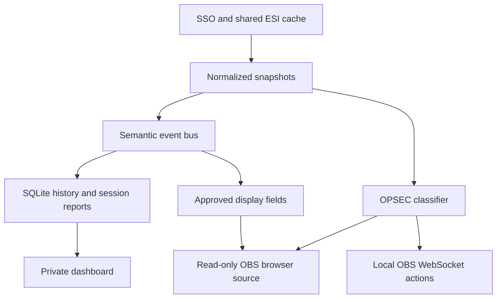

# Kairo architecture and source ownership

For adding features, start with [Internal API](INTERNAL-API.md). Exact routes and events live in [API reference](API-REFERENCE.md); current gates live in [Validation](VALIDATION.md). This page maps implementation owners without repeating the development workflow.

## Runtime boundaries

One supervisor owns the active Node runtime child and managed dataset generations. The child owns two loopback-only HTTP servers: the dashboard listener on port 4380 serves the compiled React app and authenticated local APIs; the stream listener on 4381 serves only the transparent renderer, its style/script and sanitized stream state/events. Dataset conversion runs in a cancellable worker. The supervisor drains and stops the old runtime before starting a replacement, commits a prepared generation only after startup succeeds, and retains the previous generation if startup fails.

Shutdown first stops recurring production and new HTTP admission, then drains accepted requests, dataset and collector work while their dependencies remain available. The semantic bus owns returned listener promises, including nested events; Registry cleanup and Stream/OBS disposal finish before ESI and SQLite close. Startup failure uses the same staged ownership boundaries, preserves the original error and records any secondary cleanup failures. Unresolved accepted work reaches the supervisor's failure deadline rather than being reported as a successful handoff.

The local hot path never invokes AI. SQLite is the source of truth for local history/configuration. Browser storage holds display/workspace preferences, including pilot-specific Mapper choices and map-specific display groups, plus the stream renderer's already-sanitized layout for reconnect recovery. Tokens and authoritative map records stay in the backend.

## Source map

| Source | Responsibility |
| --- | --- |
| `server/index.mjs` | HTTP boundaries, sessions, CSRF/Origin/Host checks, APIs and startup/shutdown |
| `server/auth.mjs` | Shared discovery/key flights, PKCE/state, JWT signature/claims, per-pilot token refresh and disconnect |
| `server/vault.mjs` | AES-GCM token envelope; Windows DPAPI wrapping for the vault key |
| `server/esi.mjs` | Shared caching, request deduplication, concurrency, paced reads, pagination and limit backoff |
| `server/store.mjs` | SQLite schema/migrations, snapshots and settings |
| `server/cache-retention.mjs` | Bounded maintenance of inactive transport records and terminal market jobs |
| `server/polling.mjs` | Recommended intervals, discrete choices, descriptions, input validation and sample deadlines |
| `server/core.mjs` | Scheduling, enrichment, module orchestration and UI events |
| `server/combat.mjs` | Verified attacker participation, public-reference cache, durable combat ledger and historical backfill |
| `server/markets.mjs` | Shared hub configuration, paced scan jobs, transactional books, regional histories and paginated reports |
| `server/market-history.mjs` | Shared daily archive imports, source metadata, calendar windows and ESI-compatible summaries |
| `server/market-history-worker.mjs` | Bounded bzip2/CSV decoding and validation outside the main event loop |
| `server/market-categories.mjs` | Lazy shared default taxonomy and isolated injected catalogs |
| `server/import-math.mjs` | Pure fee, order-depth, demand, pricing, ranking and cargo calculations |
| `server/imports.mjs` | Trader authorization, cached analysis, alt-order exclusions and private saved plans |
| `components/kairo/import-analyser.tsx` | Recommendation cards, detail scenarios and import-plan workflow |
| `server/goals.mjs` | Automatic goal sources, freshness checks, type resolution and durable progress accounting |
| `server/registry.mjs` | Dynamic local module registration and lifecycle |
| `server/modules/catalog.mjs` | Built-in ESI datasets, scopes and collection intervals |
| `server/universe-history.mjs` | Fresh location/ship observations into independent activity, discovery and Session services |
| `server/discovery.mjs` | Per-pilot discovered-system membership without a lifetime movement log |
| `server/session-travel.mjs` | Session-owned movement capture and bounded reads with legacy compatibility |
| `server/modules/milestones.mjs` | Skill/job state transitions into milestone events |
| `server/projections.mjs` | Record-specific widget projections, shared per-update inputs and typed toast context |
| `server/history.mjs` | Named sessions, sample capture, event boundaries and report aggregation |
| `server/session-event-window.mjs` | Shared report/replay event membership and boundary ownership |
| `server/public-feed-transport.mjs` | Core-owned R2Z2 request sharing, pacing and bounded raw packet reuse |
| `server/places.mjs` | Universe coordinates, cold legacy Journey adapters and private entity annotations |
| `server/universe-jspace.mjs` | Private Maps commands, compact library summaries and selected-map projection |
| `server/sse.mjs` | Shared ordered event writes, backpressure and bounded slow-client shutdown |
| `server/obs.mjs` | OBS v5 authentication, local connection, inventory and state action execution |
| `server/opsec.mjs` | Space classification, source precedence and bounded continuity |
| `public/stream/protection.js` | Shared state keys, labels and legacy OBS rule normalization |
| `server/stream.mjs` | Stream configuration validation, explicit projection, toast rules and output state |
| `components/kairo/` | Dashboard shell, operations views, local intelligence tools, Connections and Stream Studio |
| `public/stream/` | Small independent renderer without the dashboard application or private API access |

## Current ownership and execution

The optimisation/refactoring checkpoint covers Kairo's existing services as well as the Universe sprint. These are in-process boundaries over the existing SQLite store, shared ESI service and event bus; modules do not introduce independent collectors for data already owned by another service.

**Travel, discovery and activity.** `discovered_systems` stores unique `(character_id, system_id)` membership and is seeded once from retained visits. Universe reads this membership directly; its ordinary state/detail/planning paths do not aggregate the lifetime visit ledger. Sessions own new movement rows through `visits.session_id`. Core captures the local fresh-response receipt time, active Session, ship and available sovereignty before asynchronous display enrichment, so a delayed name lookup cannot attach an observation to a later Session. No active Session means no new movement row. Session reports and replay use bounded indexed reads and retain old rows with no explicit Session owner. General `location.changed`/`ship.changed` activity, `/api/timeline` and approved OBS notifications remain independent.

Reports and replay share event membership through `session-event-window.mjs`. Killmail occurrence times use a half-open Session interval; other events use captured boundary cursors and explicit Session ownership. Missing observation ownership remains legacy evidence, while explicit null means unowned. Reports retain their aggregation and pagination; replay retains its fixed event cursor, suppression and limit without constructing a report.

The standalone Journey page, lifetime counters, footprint preset and visit overlay are retired. `places.mjs` keeps `/api/journey`, enrichment and hidden-link operations as cold compatibility APIs over legacy rows only; new Session-owned rows cannot enter that connection-pruning contract. Old evidence and exports remain available. Saved Universe views normalize only the retired top-level `indicator: 'visits'` to `none`, preserving other configuration keys.

**Maps.** A request-scoped read context reconciles canonical expiry once, shares operational inputs, scopes selected-map link bodies in SQLite and batches full-library reads. Reverse signature bindings are built in one edge pass. Compact summaries and search avoid projecting every map's operational payload; the selected detail API supplies the opened map. The compatible full-state endpoint remains available. The frontend coalesces overlapping invalidations into one active refresh and one retained refresh, with pilot/map ownership checks before applying results. These contexts end with the request rather than caching mutable records across requests.

Mapper display projection leaves canonical nodes, coordinates, edges, route access and expiry untouched. It uses bounded saved membership lists, keeps real boundary/anchor/protected systems, and omits collapsed interior nodes from the DOM. Camera frames update imperative surfaces; optional focus detail changes only after movement settles, using inner/outer bounds to avoid edge flicker. Node bounds, connection ports, hit testing and framing all use the displayed scale.

**Shared preparation.** Route planning prepares relevant pilot evidence and a gate graph or jump index once per request/itinerary, reusing it across legs and alternate-midpoint queries. Before accepting a plan, it checks relevant evidence, itinerary revision and used connection state again. Widget bindings share one update-local set of snapshots, settings, names, goal and Session queries while retaining record ownership and freshness rules; identical binding output does not rebroadcast unchanged state. Goals share source preparation within a refresh, preserve per-goal cutoffs and durable accounting, and publish completion only after successful SQL release. Asset enrichment resolves shared containment paths once per batch; repeated identical combat evidence does not rewrite its ledger.

Import analysis shares one current Auth roster across synchronous settings, trader and order preparation. It checks current authorization again after awaited calculation and before reusing a result; there is no retained global roster cache. Default market taxonomy consumers share a read-only facade that loads the process-selected dataset and prepares its index on first use. Injected catalogs have independent ownership. Intel abbreviation lookup stores one entry per system name in three-character buckets, preserving exact matches and ambiguity checks without materializing every prefix.

**Authentication.** Each Auth instance shares cold discovery and signing-key requests, with one-hour successful caches and the existing 12-second public-request deadline. Endpoint checks precede discovery publication, failed flights clear for retry, and an unknown signing key can force a fresh key request. JWT signature/claim validation and token refresh ownership remain per pilot; sharing public metadata does not introduce token-command retries.

**Lifecycle and transport.** Shutdown first stops new admission and scheduled work, then awaits accepted HTTP handlers (including clients that already disconnected), dataset enrichment, collectors and semantic subscribers before closing their dependencies. The bus tracks promise-returning listeners and drains work they enqueue to a fixed point; module cleanup is awaited. Failures remain visible and prevent a successful managed handoff. Market decoding owns the worker until its exit, including cancellation. ESI retains the shared four-slot limiter, caching, deduplication, priority, pagination and cooldown rules. Closing ESI rejects new callers while draining already accepted request chains; read retry policy does not replay commands after an uncertain failure.

Market courtesy pacing is owned by ESI. Fresh cache hits and active shared reads are checked before waiting, then checked again before dispatch. Waiting holds neither a network slot nor a shared flight; Market cancellation and access checks still apply when the queue resumes. Accepted paced reads participate in ESI shutdown draining.

Core owns one bounded raw R2Z2 transport for Session and Universe. Only fixed credential-free public feed GETs with the same underlying fetcher share work; each consumer retains its own validation, cursor, retry policy, body limit and deadline. The provider queue bounds accepted tasks to 16, including cancelled tasks until they exit, and serializes body collection with a 110 ms dispatch floor. Pointer responses share only an active flight and invalidate packet reuse on success; failures are never cached. Successful packets are reusable for 30 seconds, with at most 32 entries and 8 MiB per fetcher. Expiry is checked on access, so idle bytes remain bounded until access or close. Cancelling one consumer leaves other subscribers intact; the last departing subscriber aborts upstream. Core closes the transport after both consumers.

**Retention.** Bounded maintenance removes eligible inactive transport data and surplus terminal scan summaries while retaining durable player evidence, complete books and daily archives. Political inference records a replay marker while disabled, then rebuilds bounded derived inputs in restartable batches; configured blocs remain available while inferred memberships wait for replay completion. See [Data retention](DATA-RETENTION.md) for the exact age, batch and capacity policies.

Dashboard and OBS event streams use `sse.mjs`: each encoded frame is shared across the audience, written in bounded chunks and resumed on `drain` without interleaving event bytes. A single large snapshot can finish; bytes/frames queued behind it and stalled writes remain bounded. Heartbeats do not build up behind data. If an OBS transition engages protection while older traffic is blocked, that client is disconnected so its renderer fails closed. Stream close removes subscriptions/timers and awaits pending output within the stall deadline.

## Universe service contracts

`createUniverse` composes private Maps, operations, feeds and navigation. Core's bounded `universe.tick()` and `universe.close()` own recurring work and shutdown. Source callbacks and accepted mutations use the existing private UI invalidation path. Disabled modules stop collection; already accepted work remains owned until it finishes.

Operational state and records stay on the authenticated dashboard API; they are absent from the separate Stream listener and from historical replay. Pilot-scoped methods validate the selected connected character. Guest records have their own bounded manual workspace; guest selection does not authorize ESI access or private Maps.

Planning an itinerary does not command the EVE client. Waypoint delivery is an explicit mutation through the navigation owner. Public-feed imports preserve provenance, and link/infrastructure imports use previewed validation. Source-data freshness, pilot access and map revision checks remain service responsibilities.

The [API reference](API-REFERENCE.md#universe-maps-and-operations) lists exact operations, inputs and response owners. [Universe](UNIVERSE.md) describes their user workflows; [Universe data](UNIVERSE-DATA.md) and [routing](UNIVERSE-ROUTING-VALIDATION.md) document geometry and planning limits.
