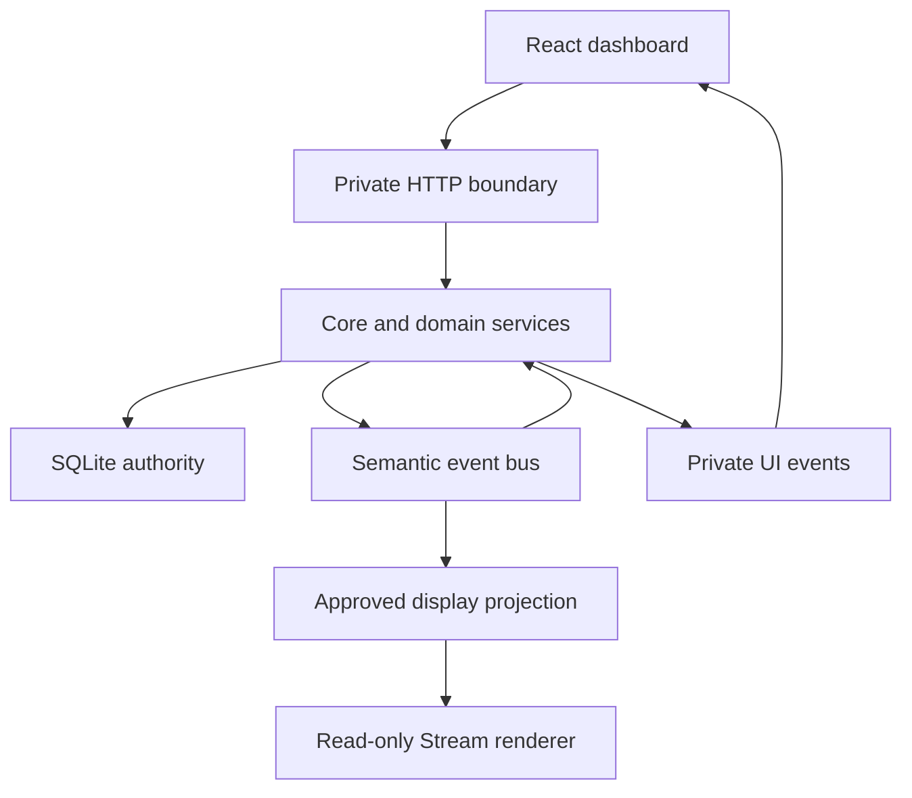

# Kairo internal API: architecture and feature development

Working draft against accepted RC17 checkpoint `a7b1bf97`. Final destination: `docs/INTERNAL-API.md`; source links below are relative to that destination. Reconcile pending accepted changes before publishing this guide as the final refactor contract.

Kairo's backbone is a set of Node services over one local SQLite store, exposed to the React dashboard through a private HTTP API and a small set of event streams. The dashboard reads projections of the authoritative records and asks services to perform commands. Services own validation, pilot access, durable writes, refresh scheduling and lifecycle. New features should join those existing owners rather than create another collector or independent copy of the same data.

## Follow one data change



For example, Core requests a due Wallet dataset through the shared ESI service. It retains the sample and its dates, sends a private snapshot update, and emits a fresh-data event for interested services. A semantic milestone can be persisted through `core.publish`; that publication also changes relevant UI resource tokens. The dashboard updates the matching pilot's snapshot, while resource owners refresh only the affected lists. Stream output is separately projected from approved fields.

An HTTP response is a view of one operation's result. An event can tell the UI that a view needs refreshing. Neither replaces SQLite history, and a missed UI event must remain recoverable by a current read or reconnect.

## Choose the right API boundary

| Boundary | Owner and callers | What belongs here |
| --- | --- | --- |
| Private dashboard HTTP | [`server/index.mjs`](../server/index.mjs), called by [`model.ts:api`](../components/kairo/model.ts) | Session/CSRF checks, request parsing, pilot validation, routing to services and JSON/error responses. |
| In-process domain services | [`core.mjs`](../server/core.mjs), Universe, Goals, Markets, Sessions, Auth | Domain validation, authoritative commands, request-scoped preparation and projections. Call these from HTTP or other owned service work. |
| Semantic events | [`bus.mjs`](../server/bus.mjs), `core.publish`, module listeners | Meaningful domain events and fresh dataset observations. Persisted semantic events and transient data events have different contracts. |
| Private UI events | Core/index plus [`ui-resources.mjs`](../server/ui-resources.mjs) | Snapshot delivery, resource invalidation, Universe/OBS/dataset status and reconnect recovery. |
| Public-facing display projection | [`projections.mjs`](../server/projections.mjs), [`stream.mjs`](../server/stream.mjs) | Explicit sanitized fields and protection state for the separate Stream renderer. |
| Durable storage | [`store.mjs`](../server/store.mjs) and domain-owned tables | Records, additive migrations, bounded indexed reads, accounting and dependency-safe close. |

These are internal alpha interfaces, not a separately versioned public SDK. Change the owner, callers, tests and documentation together when changing a contract. Compatibility endpoints such as legacy Journey remain distinct from the active Session model.

### Core's in-process facade

[`createCore`](../server/core.mjs) receives the already-open Store, Auth and ESI owners. It creates the domain services and returns the facade used by the HTTP layer. It does not open another database or provide a second authentication authority.

| Operation | Contract for callers |
| --- | --- |
| `snapshots(characterId)` | Current dataset read models, including global datasets and explicit disabled/waiting states. By default an expired ready sample is projected as stale. |
| `names()` / `rememberNames(values)` | Read the current directory; add validated positive-ID/nonempty-string entries through the owner. Do not mutate the returned shared map directly. |
| `resolveNames(data, priority?)` | Resolve supported ID fields through the shared ESI service and remember returned names. This can await external work; the caller must own that promise. |
| `requestSync(characterId)` | Request dataset work using the existing admission/deadline owners. It is not a snapshot delivery acknowledgment or a barrier for every independently running service. |
| `publish(event)` | Synchronous deduplicated history insertion followed by semantic dispatch and resource invalidation. Returned listener promises are owned by the bus; publication itself does not await all listener work. |
| `changed({characterId, resources})` | Invalidate read models without inserting a semantic history row. Recognized resources receive opaque tokens; additional resource names still travel in the event detail. |
| `updateBindings()` / `refreshOPSEC()` | Recompute approved Stream bindings or protection through their existing owners. Call after relevant accepted mutations, as existing route/service code does. |
| `health()` | Current collector IDs, ESI health and bus pending/failure information. It is operational status, not proof that every resource is fresh. |
| `quiesce()` / `close()` | Stop recurring producers; then stop admission and drain owned work. The outer runtime keeps caller-owned ESI and Store alive until Core finishes. |

Use the exposed `universe`, `goals`, `markets`, `combat`, `sessionCombat`, `stream` and `obs` services for their domain operations. Their method signatures differ deliberately; the [route reference](API-REFERENCE.md) maps HTTP operations to those owners. Some older small notes/Goals handlers still perform SQL inside the dispatcher. That is existing implementation, not a reason to bypass a newer service's validation and invalidation rules.

## HTTP contract and a first request

The runtime child serves the dashboard/private API on loopback port 4380 by default and Stream on 4381. Ports are configurable and must differ. The dashboard establishes an HttpOnly local session when its page opens. `/api/bootstrap` supplies the CSRF token, connected pilots, module/settings metadata, version and Stream origin. The route reference describes the exact guards and exceptional routes.

Use the existing helper inside React:

```ts
import {api} from './model';

const state = await api(`/state?character=${character}`);
await api('/sync', 'POST', {character}, boot.csrf);
```

`api` prefixes `/api`, JSON-encodes a supplied body, supplies the CSRF header when given, parses JSON and throws the server's error on a failed status. A `202` from `/sync` means collection was requested; it does not mean all provider data has arrived. The resulting snapshots and status must be consumed through the usual owners.

Treat each endpoint's actual response shape as its contract. Kairo does not wrap every successful response in a common `data` envelope. Parsing, domain errors, asynchronous job acceptance and optimistic conflict handling are not interchangeable; consult the specific service and route tests.

The selected UI pilot is not authorization. Server routes/services validate connected characters, current scopes and relevant resource ownership. Shared Universe datasets use owner `0`; that convention does not make arbitrary pilot-private data global. Validate numeric IDs, action choices and body sizes at the existing boundaries rather than relying on a disabled button.

The Stream listener serves only its renderer assets and read-only state/events. A feature that belongs in the private dashboard must not be added there to avoid session plumbing. Secrets, private source identifiers and arbitrary module payloads must never be copied into its display model.

## Read models, freshness and identity

The common dataset view is `ModuleState`: `status`, `data`, and applicable observation/expiry/refresh/retry dates, error, scope and truncation information. Status can be `ready`, `stale`, `missing_scope`, `waiting`, `error`, `disabled` or `not_applicable`. An unavailable sample is not a zero balance or an empty successful result.

| Field or token | Meaning | Consumer rule |
| --- | --- | --- |
| `updatedAt` | Observation time of retained data | Do not replace it with render time. |
| `expiresAt` | Provider/evidence expiry | Keep it distinct from user-selected collection intervals and protection validity. |
| `refreshAt` | Application refresh deadline where present | Derive from the observation/policy; saving a preference must not make old evidence fresh. |
| `retryAt` | Earliest retry after failure | Keep last-good data and its dates visible where the service supports that. |
| Snapshot `dataRevision` | Private process-qualified identity for the data body | Treat it as opaque. Equal data identity permits retaining the previous body reference, not ignoring changed status/error/metadata. |
| `resourceRevisions` | Process-qualified invalidation tokens for `activity`, `goals`, `notes`, `sessions`, `goalSources` | Refresh the relevant resource. These are not stored-history IDs or map edit revisions. |
| Map/entity revision | Domain-specific optimistic concurrency state | Use its service's command/conflict contract. Do not substitute a UI token. |
| Dataset revision | Active static-data generation | Use the managed restart/rebootstrap path; avoid mixing results from old and new generations. |

[`resource-state.mjs`](../components/kairo/resource-state.mjs) retains unchanged snapshot data and small metadata identities. The Assets view passes complete relevant snapshots to a memoized boundary so metadata-only changes still render. Stable identity is an optimization contract, not permission to mutate a shared object in place.

Current accepted names behavior: `/state` supplies the authoritative complete ID-to-string directory; snapshot events carry names which the dashboard merges while preserving omitted names. `mergeResourceNames` avoids copying when incoming own keys/values are unchanged. The proposed revisioned separate names event is still under review at this draft boundary and must not be described as deployed until accepted; replace this paragraph with the final wire/reconnect contract at final freeze.

## Three kinds of event

1. **Fresh dataset observation:** Core emits `data.<dataset>` on the in-process bus with `characterId` and `{current, previous}` payload. Location/ship observations can carry receipt-time Session ownership captured before awaited enrichment. These are service inputs, not automatic timeline rows or Stream notifications.
2. **Persisted semantic event:** `core.publish({type, characterId, module, summary, payload, at?, dedupe?})` inserts an event, using the supplied deduplication key when present. Only a newly inserted event is emitted and invalidates relevant UI resources. Modules receive `ctx.publish`, which supplies their module identity. Use stable domain identities in deduplication keys; include pilot ownership where needed.
3. **UI invalidation/status:** `changed`, `snapshot`, Universe/OBS and dataset events notify browser owners. `eventResources` always includes activity and adds Goals/notes/Sessions for their semantic event families. An explicit `core.changed({characterId, resources})` can invalidate read models without manufacturing a new timeline event.

Do not use semantic events for every repeated unchanged projection. For example, Goal progress updates need current read models, while completion is a latched domain event. A missed display notification cannot be used as evidence that a durable operation never happened.

The bus owns promises returned by listeners and catches failures into its health record. An asynchronous listener must return/await its work so close can drain it. Starting untracked asynchronous work inside a listener defeats that ownership. Modules install listeners synchronously in `register(ctx)` and return a disposer; a disposer may return a promise.

## Browser refresh ownership

[`dashboard.tsx`](../components/kairo/dashboard.tsx) owns the selected-pilot state and main EventSource. It fences delayed HTTP responses against later snapshot/resource events and pilot or dataset changes. Use its Context and established custom invalidations; avoid creating an EventSource for every page.

For an independently read resource, [`useResourceRefresh`](../components/kairo/use-resource-refresh.ts) wraps [`createScopedRefresh`](../components/kairo/scoped-refresh.mjs). One owner permits one active read and one retained invalidation. An invalidation while busy means one follow-up, not one queued request per event. Scope changes close the prior owner so old results cannot publish into the new pilot's page.

```ts
useResourceRefresh(
  `${character}:my-resource`,
  relevantRevision,
  () => readResource(character),
  value => setResource(value),
  error => setError(error.message),
);
```

This is a pattern with application-specific `readResource`, not an existing endpoint. Choose a scope containing every identity that owns the result. A Maps scope needs both pilot and selected map. The callback must read current arguments, and a write accepted for an old scope may still complete server-side even though its returned view must not replace the current scope.

Refresh tokens are dependencies, not a universal cache key. Map revision alone cannot describe clock deadlines, tracked pilots, operational labels or access changes. Complete snapshot metadata also matters. Use an explicit small memoized view boundary where measurements justify it; do not add a global mutable cache solely to avoid a render.

### Worked path: editing an archived Session

An existing Session label/notes edit demonstrates how the pieces fit together:

```ts
await api(
  `/sessions/${encodeURIComponent(sessionId)}?character=${character}`,
  'PUT',
  {label, notes},
  boot.csrf,
);
```

The private boundary checks the local session and CSRF token, then resolves the selected connected pilot. The Session handler trims and truncates the label to 100 characters, rejects an empty label, truncates notes to 12,000 characters and updates only a stored row belonging to that pilot. It publishes a `sessions` invalidation and refreshes relevant Stream bindings before returning `{ok:true}`. This endpoint does not return the new archive or report.

The dashboard receives `changed`; the Session owner refreshes its read model. The archive owner republishes its full loaded prefix, preserving records already paged in. A caller can request its owner's refresh after a successful write too; coalescing avoids concurrent duplicate reads. If the user changes pilot or selected Session while the save is running, let the accepted save finish but prevent its later UI result from replacing the new scope. No second EventSource, ad hoc polling loop or optimistic copy of the whole database is needed.

When adding a similar command, decide which read models actually changed. If it also creates a meaningful timeline event, use the domain's semantic publication path; if only a view changed, explicit invalidation can be sufficient. Do not add a resource name solely to an event and assume it automatically receives a token: extend `ui-resources.mjs` and its consumers when a new versioned resource is required.

Use the specialized owners where their semantics differ: Session archive refresh republishes the full loaded prefix and serializes head/tail work; administrative polling respects visible/running state and real recovery deadlines; Studio preview has debouncing, generation fences and source-aware invalidation. A generic interval must not replace those contracts.

## Storage and service lifetimes

SQLite holds authoritative Maps, Session/evidence, configuration and accounting records. Replaceable HTTP/book caches and derived indexes have different retention rules; see [DATA-RETENTION.md](DATA-RETENTION.md). Do not delete authoritative history to make a query faster or reinterpret a cache hit as fresh protected evidence.

Keep mutable read preparation local to a request/update wherever possible. Current Maps projection shares one response-local Auth roster and link/projection context, while widget bindings share source reads within one update. New awaits or later operations must recheck current authorization/freshness. Shared process-owned static Atlas/taxonomy indexes are explicitly bounded/read-only exceptions, not a pattern for caching arbitrary pilot records.

Use the owning service's mutation method. Writing its tables directly from a UI route can bypass revisions, validation, canonical links, events, accounting or cache invalidation. Some read services reconcile due canonical expiry before returning a projection, so do not assume that every service called from GET is a side-effect-free table lookup.

Startup acquires Store, Vault, Auth, ESI, Core/services and listeners in owned stages. Shutdown stops new admission and recurring producers, drains accepted handlers and their nested work, closes service/Registry/Stream/OBS owners, then closes dependencies and Store. A disconnected HTTP client does not cancel an already accepted write by itself. Worker ownership ends on actual exit, not on merely sending cancellation.

The supervisor replaces the runtime child during a managed dataset activation. A failed generation is durably rejected before best-effort cleanup, and valid prior data remains selectable. Dataset generation changes require browser recovery rather than continued use of stale static/module instances. See [DATASETS.md](DATASETS.md) and the runtime supervisor/child tests.

## Add a feature through the existing backbone

| Feature | Start here | Contracts to extend |
| --- | --- | --- |
| Existing-dataset derived tool | Domain service or trusted local module | Pilot/record ownership, fresh-data or semantic inputs, scoped read model, appropriate invalidation. |
| New ESI dataset | `server/modules/catalog.mjs`, `server/polling.mjs`, Core enrichment where needed | Route/scopes, shared/private ownership, pagination, refresh/expiry/error handling and shared ESI admission. |
| New command and read view | Domain service, then `server/index.mjs`, then UI owner | Validated inputs, atomic durable changes, expected revisions, precise response/error shape and relevant events. |
| Local extension page | `server/registry.mjs` module descriptor and `read` function | Unique module ID/version, migration, enable/disable cleanup, typed rows/columns and pilot filter. |
| New Stream widget/toast | `projections.mjs`, `stream.mjs`, shared renderer/Studio contract | Explicit safe fields, exact record owner, freshness, immediate protection and recovery state. |

Dynamic modules are trusted local `.mjs` files discovered at startup. The Registry supplies `store`, `db`, `esi`, `on`, namespaced `get/set` and `publish`; it tracks subscriptions and cleanup. Keep `register` synchronous and return cleanup explicitly. Its versioned migration hook runs during activation of a registering module; it is not an automatic transaction around arbitrary asynchronous setup. Use the established examples in [`modules/milestones.mjs`](../server/modules/milestones.mjs) and [ARCHITECTURE.md](ARCHITECTURE.md).

Adding dataset names to a dynamic descriptor does not extend Core's built-in collection loop: the catalog owns that scheduling. Likewise, a dynamic private page does not grant arbitrary HTML or code execution in the Stream renderer.

For a feature touching existing state, first identify its authority and lifecycle owner. Add the service operation and focused behavioral tests. Expose a route through existing request guards, then connect its read model to a scoped UI owner and precise invalidation. Add Stream projection only if the feature actually needs broadcast output. Finally verify a compiled end-to-end path and realistic changed/unchanged costs for any performance-sensitive claim.

## Tests that define the contract

Choose tests for the behavior being changed: wrong pilot/scope/record, stale or disabled evidence, exact expiry, failed provider and retry, old HTTP result after newer events, revision conflict, accepted old-scope saves, reconnect, shutdown with pending work, rollback and replay ownership. Use real source paths and complete outputs; a request count alone is not a speed comparison.

Run `npm run check:kairo`, a fresh `npm run build`, and the affected `tests/kairo` tests. Build before HTTP tests that require compiled entrypoints. The final combined gate includes the full suite and compiled browser/service comparisons. When optimizing, record the source/build and harness identities, keep ordinary timing separate from counters/profiles/forced collection, retain adverse small cases and first-use costs, and verify complete output/freshness equality. A passing ordinary test-build workflow does not replace that final matrix.

Keep this guide, the route reference and existing domain documentation synchronized with an accepted API change. Document who owns the state, how a caller learns it changed, and how pending work finishes; those three answers make subsequent features easier to build without bypassing the refactor's guarantees.
