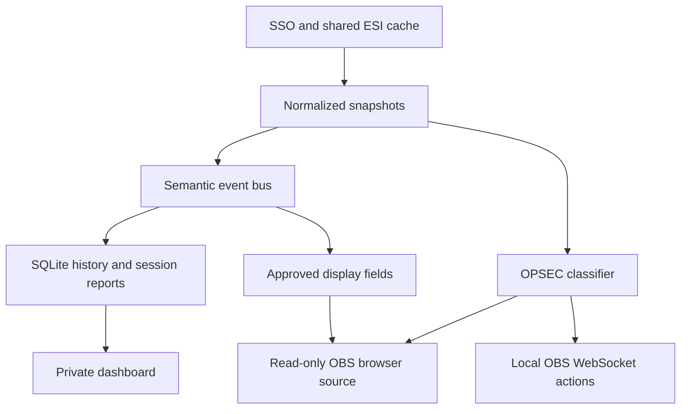

# Kairo architecture and source ownership

This is the architecture of the **0.8.0 feature set at candidate `0.8.0-rc.17`**. It describes implemented source, not a stable-release announcement or a future design. Start development with [local setup and workflows](DEVELOPMENT.md), use [Internal API](INTERNAL-API.md) to extend the application, and use [API reference](API-REFERENCE.md) for wire contracts. [Validation](VALIDATION.md) owns acceptance evidence and environment limits.

## Repository map

| Location | Role |
| --- | --- |
| `app/` | React application entry, layout and global styles. |
| `components/kairo/` | Product pages, models, resource owners and interactive Atlas/Maps components. |
| `components/ui/`, `hooks/`, `lib/` | Shared presentation primitives and retained scaffold utilities. |
| `server/` | Shipped local Node runtime, HTTP boundaries and domain services. |
| `server/modules/` | Built-in collection catalog and trusted local event extensions. |
| `server/data/` | Bundled static-data fallback, provenance and lookup assets. A managed generation replaces official SDE components at process startup; supplemental bundled data keeps its own source. |
| `public/stream/` | Independent OBS renderer; never imports the private dashboard. |
| `scripts/`, `build/` | Build, static-data, packaging and browser/performance verification tooling. See [Development](DEVELOPMENT.md) before choosing a command. |
| `tests/kairo/` | Node behavioral tests for services, owners, boundaries and recovery. |
| `examples/` | Example configuration/import material; verify it against the current owning service. |
| `worker/`, `db/`, `drizzle/` | Retained web scaffold. These are not Kairo's local runtime or the owner of its SQLite schema. |
| `docs/` | Maintained user/developer guidance; [history](history/README.md) identifies older investigations and evidence. |

`server/store.mjs` owns the local schema. Do not apply scaffold database instructions to the Kairo data directory. The packaged client is compiled before use; the Node runtime serves those files without a development frontend server.

## Runtime boundaries

One supervisor owns the active Node runtime child and managed dataset generations. The child owns two loopback-only HTTP servers: the dashboard listener on default port 4380 serves the compiled React app and authenticated local APIs; the stream listener on default port 4381 serves only the transparent renderer, its style/script and sanitized stream state/events. Dataset conversion runs in a cancellable worker. The supervisor drains and stops the old runtime before starting a replacement, commits a prepared generation only after startup succeeds, and retains the previous generation if startup fails.

Shutdown first stops recurring production and new HTTP admission, then drains accepted requests, dataset and collector work while their dependencies remain available. The semantic bus owns returned listener promises, including nested events; Registry cleanup and Stream/OBS disposal finish before ESI and SQLite close. Startup failure uses the same staged ownership boundaries, preserves the original error and records any secondary cleanup failures. Unresolved accepted work reaches the supervisor's failure deadline rather than being reported as a successful handoff.

The local hot path never invokes AI. SQLite is the source of truth for local history/configuration. Browser storage holds display/workspace preferences, including pilot-specific Mapper choices and map-specific display groups, plus the stream renderer's already-sanitized layout for reconnect recovery. Tokens and authoritative map records stay in the backend.

## Runtime service ownership

| Source | Responsibility |
| --- | --- |
| `server/start.mjs`, `runtime-supervisor.mjs`, `runtime-lock.mjs` | Launch, exclusive runtime/data-directory lease, child activation and recovery. |
| `server/runtime-child.mjs` | Supervisor IPC, runtime startup and deadline-bounded stop acknowledgment. |
| `server/datasets.mjs`, `sde-worker.mjs` | Static-data checking/download/preparation and cancellable conversion. See [Datasets](DATASETS.md). |
| `server/index.mjs` | HTTP boundaries, sessions, CSRF/Origin/Host checks, APIs and startup/shutdown |
| `server/auth.mjs` | Shared discovery/key flights, PKCE/state, JWT signature/claims, per-pilot token refresh and disconnect |
| `server/vault.mjs` | AES-GCM token envelope; Windows DPAPI wrapping for the vault key |
| `server/esi.mjs` | Shared caching, request deduplication, concurrency, paced reads, pagination and limit backoff |
| `server/store.mjs` | SQLite schema/migrations, snapshots and settings |
| `server/cache-retention.mjs` | Bounded maintenance of inactive transport records and terminal market jobs |
| `server/polling.mjs` | Recommended intervals, discrete choices, descriptions, input validation and sample deadlines |
| `server/core.mjs` | Scheduling, enrichment, module orchestration and UI events |
| `server/combat.mjs` | Verified attacker participation, public-reference cache, durable combat ledger and historical backfill |
| `server/markets.mjs` | Shared hub configuration, paced scan jobs, transactional books, regional histories and paginated reports |
| `server/market-history.mjs` | Shared daily archive imports, source metadata, calendar windows and ESI-compatible summaries |
| `server/market-history-worker.mjs` | Bounded bzip2/CSV decoding and validation outside the main event loop |
| `server/market-categories.mjs` | Lazy shared default taxonomy and isolated injected catalogs |
| `server/import-math.mjs` | Pure fee, order-depth, demand, pricing, ranking and cargo calculations |
| `server/imports.mjs` | Trader authorization, cached analysis, alt-order exclusions and private saved plans |
| `components/kairo/import-analyser.tsx` | Recommendation cards, detail scenarios and import-plan workflow |
| `server/goals.mjs` | Automatic goal sources, freshness checks, type resolution and durable progress accounting |
| `server/registry.mjs` | Dynamic local module registration and lifecycle |
| `server/modules/catalog.mjs` | Built-in ESI datasets, scopes and collection intervals |
| `server/universe-history.mjs` | Fresh location/ship observations into independent activity, discovery and Session services |
| `server/discovery.mjs` | Per-pilot discovered-system membership without a lifetime movement log |
| `server/session-travel.mjs` | Session-owned movement capture and bounded reads with legacy compatibility |
| `server/modules/milestones.mjs` | Skill/job state transitions into milestone events |
| `server/projections.mjs` | Record-specific widget projections, shared per-update inputs and typed toast context |
| `server/history.mjs` | Named sessions, sample capture, event boundaries and report aggregation |
| `server/session-event-window.mjs` | Shared report/replay event membership and boundary ownership |
| `server/public-feed-transport.mjs` | Core-owned R2Z2 request sharing, pacing and bounded raw packet reuse |
| `server/places.mjs` | Shared system metadata and private entity annotations |
| `server/universe-jspace.mjs` | Private Maps commands, compact library summaries and selected-map projection |
| `server/sse.mjs` | Shared ordered event writes, backpressure and bounded slow-client shutdown |
| `server/obs.mjs` | OBS v5 authentication, local connection, inventory and state action execution |
| `server/opsec.mjs` | Space classification, source precedence and bounded continuity |
| `public/stream/protection.js` | Shared state keys, labels and legacy OBS rule normalization |
| `server/stream.mjs` | Stream configuration validation, explicit projection, toast rules and output state |
| `components/kairo/` | Dashboard shell, operations views, local intelligence tools, Connections and Stream Studio |
| `public/stream/` | Small independent renderer without the dashboard application or private API access |

## Module catalog and feature ownership

A dashboard page is not necessarily a collector, and a collector can supply several pages. [`server/modules/catalog.mjs`](../server/modules/catalog.mjs) owns the built-in dataset definitions. Core collects enabled pilot modules for each connected pilot and the Universe module once under owner `0`.

| Catalog module | Dataset keys | Main consumers |
| --- | --- | --- |
| `pilot` | `profile`, `location`, `ship`, `online` | Overview, OPSEC, Universe, Sessions and bindings. |
| `training` | `skills`, `queue`, `attributes`, `clones`, `implants` | Training, Goals, milestones and widgets. |
| `wallet` | `wallet`, `journal`, `transactions`, `orders` | Wallet/trade, Import Analyser, Goals and Sessions. |
| `markets` | No scheduled catalog datasets | On-demand scans, hub books, regional histories and Import Analyser through `markets.mjs`/`imports.mjs`. |
| `hangar` | `assets`, `fittings`, `contracts` | Hangar, Goals and location/type enrichment. |
| `industry` | `jobs`, `blueprints`, `mining`, `planets` | Industry views, milestones, Goals and Sessions. |
| `combat` | `killmails`, `standings`, `loyalty` | Combat, Goals and Sessions, supplemented by the Combat/Session combat owners. |
| `opsec` | `contacts`, `corporation_contacts`, `alliance_contacts` | Protection classification and standing-aware Universe views. |
| `comms` | `calendar`, `notifications`, `mail` | Private communications views; mail bodies are not collected here. |
| `universe` | `status`, `prices`, `sovereignty`, `fw`, `kills`, `jumps`, `sovereignty_campaigns`, `incursions`, `industry_systems` | Shared public state, map overlays, routing, OPSEC and prices. |

The shipped Registry extension `milestones` subscribes to shared observations; it has no independent ESI collector or page. Goals, notes, Sessions, Stream Studio and the private Maps workspace are services/workflows over this backbone. [Authentication and security](AUTH-AND-SECURITY.md) owns scope details, while [ESI polling](ESI-POLLING.md) owns collection cadence.

Module disable affects its owner's collection/subscriptions; it does not erase retained history. Accepted work remains owned until it finishes or becomes inapplicable. New features should consume an existing service or observation before proposing another network loop.

## Startup, shutdown and replacement

1. `server/start.mjs` enters the lean supervisor. It obtains the exclusive data-directory lease before inspecting managed generations and starts one runtime child with the selected dataset directory.
2. The child loads `index.mjs`. `startKairo` opens Store/Vault/Auth/ESI, constructs Core and its services, initializes the dataset service, then binds both loopback listeners. Core constructs Universe, history subscriptions, Registry, Stream/OBS, Goals, Markets, Combat and Session combat around the same Store and ESI owners.
3. The child reports readiness. The supervisor commits a pending generation only after successful startup and tells the child it is activated; automatic dataset work then starts. Ordinary collection obeys its own deadlines rather than fetching every item on every timer tick.
4. Shutdown refuses new HTTP work, quiesces Core timers and closes the dataset service. It starts closing UI streams and waits for accepted dashboard handlers, including a write whose client disconnected. Core then drains collectors/enrichment, domain services, returned bus-listener promises and Registry cleanup before closing Stream/OBS and the bus.
5. The outer runtime closes ESI, HTTP connections/listeners and Store after their dependents finish. Only then does the child acknowledge a successful stop. The supervisor requires both stop acknowledgment and child exit before replacement.

Core's scheduler wakes every three seconds and its SSE/binding heartbeat every ten seconds. These are orchestration timers, not ESI polling promises. Per-dataset refresh/expiry/retry deadlines, in-flight sharing and disabled modules still control dispatch.

A module must return asynchronous listener/cleanup work to its owner. Bus drain follows nested events to a fixed point; untracked promises cannot be included. Startup failure follows staged cleanup, preserves the original failure and retains cleanup diagnostics. Accepted work that cannot drain is a failed stop, not a successful update handoff. Default supervisor startup and child/stop deadlines are 60 and 30 seconds respectively; they are lifecycle failure bounds, not normal response time targets.

Dataset replacement preserves in-memory dashboard sessions across the controlled child handoff. Recovery, cancellation, pending-generation markers and rollback are specified in [Datasets](DATASETS.md). Direct `startKairo(...)` is used by tests and embedding; without the supervisor's activation callback it does not implement managed process replacement.

## Domain execution boundaries

### Travel, discovery and activity

 `discovered_systems` stores unique `(character_id, system_id)` membership and is seeded once from retained visits. Universe reads this membership directly; its ordinary state/detail/planning paths do not aggregate the lifetime visit ledger. Sessions own new movement rows through `visits.session_id`. Core captures the local fresh-response receipt time, active Session, ship and available sovereignty before asynchronous display enrichment, so a delayed name lookup cannot attach an observation to a later Session. No active Session means no new movement row. Session reports and replay use bounded indexed reads and retain old rows with no explicit Session owner. General `location.changed`/`ship.changed` activity, `/api/timeline` and approved OBS notifications remain independent.

Reports and replay share event membership through `session-event-window.mjs`. Killmail occurrence times use a half-open Session interval; other events use captured boundary cursors and explicit Session ownership. Missing observation ownership remains legacy evidence, while explicit null means unowned. Reports retain their aggregation and pagination; replay retains its fixed event cursor, suppression and limit without constructing a report.

Journey is removed: no Journey HTTP handlers, lifetime aggregation, hidden-link storage/export or prior unowned-visit inference remains. Session travel reads only its captured start and explicitly owned visits; discovery is recorded independently from current observations. `places.mjs` retains shared system metadata and private entity annotations. The constant `#journey` alias opens Atlas without a Journey service. Saved Universe views normalize the retired top-level `indicator: 'visits'` to `none`, preserving other configuration keys.

### Maps and navigation

 A request-scoped read context reconciles canonical expiry once, shares operational inputs, scopes selected-map link bodies in SQLite and batches full-library reads. Reverse signature bindings are built in one edge pass. Compact summaries and search avoid projecting every map's operational payload; the selected detail API supplies the opened map. The compatible full-state endpoint remains available. The frontend coalesces overlapping invalidations into one active refresh and one retained refresh, with pilot/map ownership checks before applying results. These contexts end with the request rather than caching mutable records across requests.

Mapper display projection leaves canonical nodes, coordinates, edges, route access and expiry untouched. It uses bounded saved membership lists, keeps real boundary/anchor/protected systems, and omits collapsed interior nodes from the DOM. Camera frames update imperative surfaces; optional focus detail changes only after movement settles, using inner/outer bounds to avoid edge flicker. Node bounds, connection ports, hit testing and framing all use the displayed scale.

### Shared preparation

 Route planning prepares relevant pilot evidence and a gate graph or jump index once per request/itinerary, reusing it across legs and alternate-midpoint queries. Before accepting a plan, it checks relevant evidence, itinerary revision and used connection state again. Widget bindings share one update-local set of snapshots, settings, names, goal and Session queries while retaining record ownership and freshness rules; identical binding output does not rebroadcast unchanged state. Goals share source preparation within a refresh, preserve per-goal cutoffs and durable accounting, and publish completion only after successful SQL release. Asset enrichment resolves shared containment paths once per batch; repeated identical combat evidence does not rewrite its ledger.

Import analysis shares one current Auth roster across synchronous settings, trader and order preparation. It checks current authorization again after awaited calculation and before reusing a result; there is no retained global roster cache. Default market taxonomy consumers share a read-only facade that loads the process-selected dataset and prepares its index on first use. Injected catalogs have independent ownership. Intel abbreviation lookup stores one entry per system name in three-character buckets, preserving exact matches and ambiguity checks without materializing every prefix.

### Authentication and private collection

Auth owns OAuth discovery/signing-key sharing, PKCE/state, per-pilot refresh and local connection revisions. Core/ESI and composite private services retain the connection that admitted a read or command and recheck it before publishing after an await. Disconnect/reconnect is a new ownership boundary; routine access-token rotation is not. See [Authentication and security](AUTH-AND-SECURITY.md) for the full contract.

### Transport and output

ESI owns shared caching, deduplication, concurrency, priority, pagination and cooldown rules. Closing ESI refuses new callers while draining accepted request chains. Read retry policy does not replay commands after an uncertain failure. Market decoding owns its worker until actual exit, including cancellation.

Market courtesy pacing is owned by ESI. Fresh cache hits and active shared reads are checked before waiting, then checked again before dispatch. Waiting holds neither a network slot nor a shared flight; Market cancellation and access checks still apply when the queue resumes. Accepted paced reads participate in ESI shutdown draining.

Core owns one bounded raw R2Z2 transport for Session and Universe. Only fixed credential-free public feed GETs with the same underlying fetcher share work; each consumer retains its own validation, cursor, retry policy, body limit and deadline. The provider queue bounds accepted tasks to 16, including cancelled tasks until they exit, and serializes body collection with a 110 ms dispatch floor. Pointer responses share only an active flight and invalidate packet reuse on success; failures are never cached. Successful packets are reusable for 30 seconds, with at most 32 entries and 8 MiB per fetcher. Expiry is checked on access, so idle bytes remain bounded until access or close. Cancelling one consumer leaves other subscribers intact; the last departing subscriber aborts upstream. Core closes the transport after both consumers.

### Retention

Bounded maintenance removes eligible inactive transport data and surplus terminal scan summaries while retaining durable player evidence, complete books and daily archives. Political inference records a replay marker while disabled, then rebuilds bounded derived inputs in restartable batches; configured blocs remain available while inferred memberships wait for replay completion.

[Persistence](PERSISTENCE.md) describes schema/data ownership and migration practices. [Data retention](DATA-RETENTION.md) is authoritative for age, capacity and cleanup policies.

## Frontend and display boundaries

`dashboard.tsx` owns selected-pilot state, bootstrap recovery and the one private EventSource. Page owners consume shared snapshots or scoped service reads. HTTP results can arrive after a pilot change, a newer event, a new draft edit or dataset replacement; each resource must retain the appropriate ownership/generation fence. [Internal API](INTERNAL-API.md#browser-refresh-ownership) describes the existing refresh/save owners and extension patterns.

Atlas geometry and worker/layout helpers are distinct from canonical navigation data. Maps display groups, zoom and camera transforms affect projection only; they must not rewrite canonical links, coordinates or access. Browser preferences are convenient local state, not an authorization or persistence substitute for the private backend.

Stream output has a separate display DTO and listener. `projections.mjs` explicitly selects source values; `stream.mjs` sanitizes config and emits display state; `public/stream/` renders it. Private notes, authentication, raw ESI snapshots and arbitrary Registry payloads do not belong on that listener. Configured overlay text can still disclose what the user chooses to write.

Dashboard and OBS streams share `sse.mjs`, with bounded queuing, ordered frames and slow-client shutdown. Protection can disconnect a backlogged OBS client so the renderer fails closed. Exact wire shapes, reconnect semantics and transport bounds live in [API reference](API-REFERENCE.md#dashboard-sse-and-client-invalidation).

## Universe service contracts

`createUniverse` composes private Maps, operations, feeds and navigation. Core's bounded `universe.tick()` and `universe.close()` own recurring work and shutdown. Source callbacks and accepted mutations use the existing private UI invalidation path. Disabled modules stop collection; already accepted work remains owned until it finishes.

Operational state and records stay on the authenticated dashboard API; they are absent from the separate Stream listener and from historical replay. Pilot-scoped methods validate the selected connected character. Guest records have their own bounded manual workspace; guest selection does not authorize ESI access or private Maps.

Planning an itinerary does not command the EVE client. Waypoint delivery is an explicit mutation through the navigation owner. Public-feed imports preserve provenance, and link/infrastructure imports use previewed validation. Source-data freshness, pilot access and map revision checks remain service responsibilities.

The [API reference](API-REFERENCE.md#universe-maps-and-operations) lists exact operations, inputs and response owners. [Universe](UNIVERSE.md) describes their user workflows; [Universe data](UNIVERSE-DATA.md) and [routing](UNIVERSE-ROUTING-VALIDATION.md) document geometry and planning limits.
