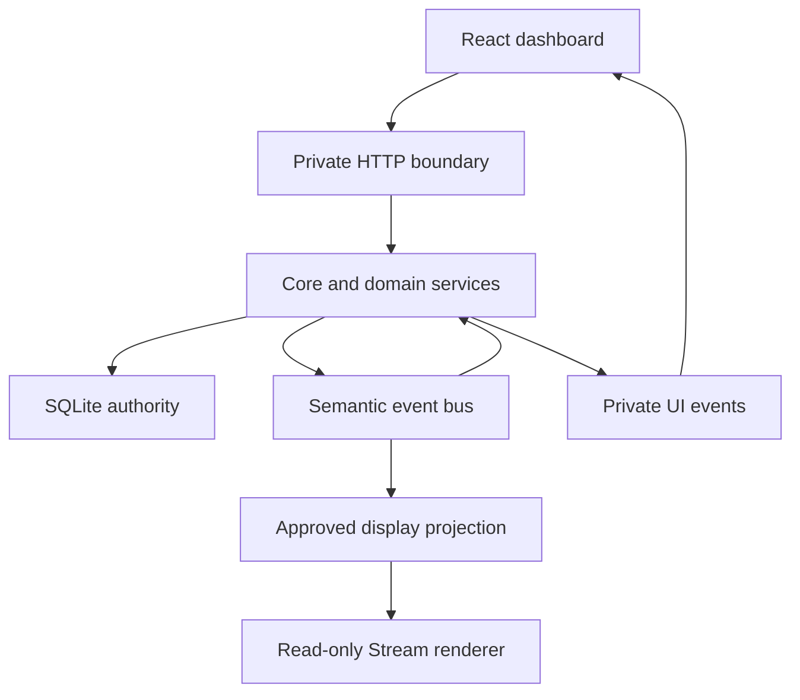

# Kairo internal API: architecture and feature development

This guide explains module interoperability and safe feature development for the **0.8.0 feature set at `0.8.0-rc.17`**. These are internal candidate interfaces, not a stable public SDK. Use [Architecture](ARCHITECTURE.md) to find an owner, [Development](DEVELOPMENT.md) for setup/commands, [API reference](API-REFERENCE.md) for wire contracts, and [Validation](VALIDATION.md) for release status.

Kairo's backbone is a set of Node services over one local SQLite store, exposed to the React dashboard through a private HTTP API and a small set of event streams. The dashboard reads projections of the authoritative records and asks services to perform commands. Services own validation, pilot access, durable writes, refresh scheduling and lifecycle. New features should join those existing owners rather than create another collector or independent copy of the same data.

## Follow one data change



For example, Core requests a due Wallet dataset through the shared ESI service. It retains the sample and its dates, sends any changed global name directory needed by connected dashboards before the private snapshot update, and emits a fresh-data event for interested services. A semantic milestone can be persisted through `core.publish`; that publication also changes relevant UI resource tokens. The dashboard updates the matching pilot's snapshot, while resource owners refresh only the affected lists. Stream output is separately projected from approved fields.

An HTTP response is a view of one operation's result. An event can tell the UI that a view needs refreshing. Neither replaces SQLite history, and a missed UI event must remain recoverable by a current read or reconnect.

## Choose the right API boundary

| Boundary | Owner and callers | What belongs here |
| --- | --- | --- |
| Private dashboard HTTP | [`server/index.mjs`](../server/index.mjs), called by [`model.ts:api`](../components/kairo/model.ts) | Session/CSRF checks, request parsing, pilot validation, routing to services and JSON/error responses. |
| In-process domain services | [`core.mjs`](../server/core.mjs), Universe, Goals, Markets, Sessions, Auth | Domain validation, authoritative commands, request-scoped preparation and projections. Call these from HTTP or other owned service work. |
| Semantic events | [`bus.mjs`](../server/bus.mjs), `core.publish`, module listeners | Meaningful domain events and fresh dataset observations. Persisted semantic events and transient data events have different contracts. |
| Private UI events | Core/index plus [`ui-resources.mjs`](../server/ui-resources.mjs) | Snapshot delivery, resource invalidation, Universe/OBS/dataset status and reconnect recovery. |
| Public-facing display projection | [`projections.mjs`](../server/projections.mjs), [`stream.mjs`](../server/stream.mjs) | Explicit sanitized fields and protection state for the separate Stream renderer. |
| Durable storage | [`store.mjs`](../server/store.mjs) and domain-owned tables | Records, additive migrations, bounded indexed reads, accounting and dependency-safe close. |

These are internal alpha interfaces, not a separately versioned public SDK. Change the owner, callers, tests and documentation together when changing a contract. Compatibility endpoints such as legacy Journey remain distinct from the active Session model.

### Core's in-process facade

[`createCore`](../server/core.mjs) receives the already-open Store, Auth and ESI owners. It creates the domain services and returns the facade used by the HTTP layer. It does not open another database or provide a second authentication authority.

| Operation | Contract for callers |
| --- | --- |
| `snapshots(characterId)` | Current dataset read models, including global datasets and explicit disabled/waiting states. By default an expired ready sample is projected as stale. |
| `names()` / `rememberNames(values)` | Read the current directory; persist validated positive-ID/nonempty-string changes through the owner. A real change advances the names revision, but individual calls do not broadcast. Do not mutate the returned shared map directly. |
| `namesSnapshot()` | Read `{names,namesRevision}` for response encoding. The map is shared, not a detached copy; serialize through the current owner and do not mutate it. |
| `connectUI(response)` | Admit a private UI SSE response, bootstrap its full current name directory and remove it on close. New connections are rejected after Core stops admission. Use this owner instead of adding responses directly to `uiClients`. |
| `resolveNames(data, priority?)` | Resolve supported ID fields through the shared ESI service and remember returned names. This can await external work; the caller must own that promise. |
| `requestSync(characterId)` | Request dataset work using the existing admission/deadline owners. It is not a snapshot delivery acknowledgment or a barrier for every independently running service. |
| `publish(event)` | Synchronous deduplicated history insertion followed by semantic dispatch and resource invalidation. Returned listener promises are owned by the bus; publication itself does not await all listener work. |
| `changed({characterId, resources})` | Invalidate read models without inserting a semantic history row. Recognized resources receive opaque tokens; additional resource names still travel in the event detail. |
| `updateBindings()` / `refreshOPSEC()` | Recompute approved Stream bindings or protection through their existing owners. Call after relevant accepted mutations, as existing route/service code does. |
| `health()` | Current collector IDs, ESI health and bus pending/failure information. It is operational status, not proof that every resource is fresh. |
| `quiesce()` / `close()` | Stop recurring producers; then stop admission and drain owned work. The outer runtime keeps caller-owned ESI and Store alive until Core finishes. |

Use the exposed `universe`, `goals`, `markets`, `combat`, `sessionCombat`, `stream` and `obs` services for their domain operations. Their method signatures differ deliberately; the [route reference](API-REFERENCE.md) maps HTTP operations to those owners. Some older small notes/Goals handlers still perform SQL inside the dispatcher. That is existing implementation, not a reason to bypass a newer service's validation and invalidation rules.

## HTTP contract and a first request

The runtime child serves the dashboard/private API on loopback port 4380 by default and Stream on 4381. Ports are configurable and must differ. The dashboard establishes an HttpOnly local session when its page opens. `/api/bootstrap` supplies the CSRF token, connected pilots, module/settings metadata, version and Stream origin. The route reference describes the exact guards and exceptional routes.

Use the existing helper inside React:

```ts
import {api} from './model';

const state = await api(`/state?character=${character}`);
await api('/sync', 'POST', {character}, boot.csrf);
```

`api` prefixes `/api`, JSON-encodes a supplied body, supplies the CSRF header when given, parses JSON and throws the server's error on a failed status. A `202` from `/sync` means collection was requested; it does not mean all provider data has arrived. The resulting snapshots and status must be consumed through the usual owners.

Treat each endpoint's actual response shape as its contract. Kairo does not wrap every successful response in a common `data` envelope. Parsing, domain errors, asynchronous job acceptance and optimistic conflict handling are not interchangeable; consult the specific service and route tests.

The selected UI pilot is not authorization. Server routes/services validate connected characters, current scopes and relevant resource ownership. Shared Universe datasets use owner `0`; that convention does not make arbitrary pilot-private data global. Validate numeric IDs, action choices and body sizes at the existing boundaries rather than relying on a disabled button.

The Stream listener serves only its renderer assets and read-only state/events. A feature that belongs in the private dashboard must not be added there to avoid session plumbing. Secrets, private source identifiers and arbitrary module payloads must never be copied into its display model.

## Read models, freshness and identity

The common dataset view is `ModuleState`: `status`, `data`, and applicable observation/expiry/refresh/retry dates, error, scope and truncation information. Status can be `ready`, `stale`, `missing_scope`, `waiting`, `error`, `disabled` or `not_applicable`. An unavailable sample is not a zero balance or an empty successful result.

| Field or token | Meaning | Consumer rule |
| --- | --- | --- |
| `updatedAt` | Observation time of retained data | Do not replace it with render time. |
| `expiresAt` | Provider/evidence expiry | Keep it distinct from user-selected collection intervals and protection validity. |
| `refreshAt` | Application refresh deadline where present | Derive from the observation/policy; saving a preference must not make old evidence fresh. |
| `retryAt` | Earliest retry after failure | Keep last-good data and its dates visible where the service supports that. |
| Snapshot `dataRevision` | Private process-qualified identity for the data body | Treat it as opaque. Equal data identity permits retaining the previous body reference, not ignoring changed status/error/metadata. |
| `namesRevision` | Process-qualified identity for the global private names directory | Let `name-directory-state.mjs` own equality, within-epoch ordering and reconnect/reset handling. It is not a timestamp, per-pilot token or durable history ID. |
| `resourceRevisions` | Process-qualified invalidation tokens for `activity`, `goals`, `notes`, `sessions`, `goalSources` | Refresh the relevant resource. These are not stored-history IDs or map edit revisions. |
| Map/entity revision | Domain-specific optimistic concurrency state | Use its service's command/conflict contract. Do not substitute a UI token. |
| Dataset revision | Active static-data generation | Use the managed restart/rebootstrap path; avoid mixing results from old and new generations. |

[`resource-state.mjs`](../components/kairo/resource-state.mjs) retains unchanged snapshot data and small metadata identities. The Assets view passes complete relevant snapshots to a memoized boundary so metadata-only changes still render. Stable identity is an optimization contract, not permission to mutate a shared object in place.

The global names directory has one Core owner and one dashboard owner, independent of the selected pilot. Let [`name-directory-state.mjs`](../components/kairo/name-directory-state.mjs) reconcile names revisions, authoritative replacements, process-epoch changes and delayed HTTP reads. Keep names, snapshot, resource, pilot and dataset fences separate. The full protocol and legacy fallback rules have one home in [Dashboard SSE](API-REFERENCE.md#dashboard-sse-and-client-invalidation).

## Three kinds of event

1. **Fresh dataset observation:** Core emits `data.<dataset>` on the in-process bus with `characterId` and `{current, previous}` payload. Location, ship, skills and industry-job observations carry receipt-time Session ownership captured before awaited enrichment. These are service inputs, not automatic timeline rows or Stream notifications. `skill.completed` and `industry.ready` preserve that local receipt time and explicit `payload.session_id` (an ID or null); missing ownership remains legacy evidence. Optional name failure must not discard a completion. Wallet journal events retain their authoritative journal dates.
2. **Persisted semantic event:** `core.publish({type, characterId, module, summary, payload, at?, dedupe?})` inserts an event, using the supplied deduplication key when present. Only a newly inserted event is emitted and invalidates relevant UI resources. Modules receive `ctx.publish`, which supplies their module identity. Use stable domain identities in deduplication keys; include pilot ownership where needed.
3. **UI invalidation/status:** `names`, `changed`, `snapshot`, Universe/OBS and dataset events notify browser owners. The private `names` event carries the complete global directory; snapshot data still follows pilot ownership. `eventResources` always includes activity and adds Goals/notes/Sessions for their semantic event families. An explicit `core.changed({characterId, resources})` can invalidate read models without manufacturing a new timeline event.

Do not use semantic events for every repeated unchanged projection. For example, Goal progress updates need current read models, while completion is a latched domain event. A missed display notification cannot be used as evidence that a durable operation never happened.

The bus owns promises returned by listeners and catches failures into its health record. An asynchronous listener must return/await its work so close can drain it. Starting untracked asynchronous work inside a listener defeats that ownership. Modules install listeners synchronously in `register(ctx)` and return a disposer; a disposer may return a promise.

## Browser refresh ownership

[`dashboard.tsx`](../components/kairo/dashboard.tsx) owns the selected-pilot state and main EventSource. It fences delayed HTTP responses against later names/snapshot/resource events and pilot, connection or dataset changes. A clean first EventSource open alone does not invalidate a pending initial names read; a later names event does. After an initial connection error, the first successful open requests recovery through the existing scoped refresh owner. Use its Context and established custom invalidations; avoid creating an EventSource for every page.

For an independently read resource, [`useResourceRefresh`](../components/kairo/use-resource-refresh.ts) wraps [`createScopedRefresh`](../components/kairo/scoped-refresh.mjs). One owner permits one active read and one retained invalidation. An invalidation while busy means one follow-up, not one queued request per event. Scope changes close the prior owner so old results cannot publish into the new pilot's page.

```ts
useResourceRefresh(
  `${character}:my-resource`,
  relevantRevision,
  () => readResource(character),
  value => setResource(value),
  error => setError(error.message),
);
```

This is a pattern with application-specific `readResource`, not an existing endpoint. Choose a scope containing every identity that owns the result. A Maps scope needs both pilot and selected map. The callback must read current arguments, and a write accepted for an old scope may still complete server-side even though its returned view must not replace the current scope.

Refresh tokens are dependencies, not a universal cache key. Map revision alone cannot describe clock deadlines, tracked pilots, operational labels or access changes. Complete snapshot metadata also matters. Use an explicit small memoized view boundary where measurements justify it; do not add a global mutable cache solely to avoid a render.

The Maps workspace consumes current wall time with each new complete map/summary/feed publication. `createJSpaceClock.refresh(records, renderedAt)` then owns expiry scheduling without publishing another identical-data render. Its independent 30-second cadence, visibility refresh and render-to-effect deadline checks keep time-dependent state fresh; a wall-clock rollback publishes immediately. Callers that omit `renderedAt` retain the immediate-refresh behavior. Do not replace this owner with revision-only memoization or reset its cadence on each snapshot.

### Worked path: editing an archived Session

An existing Session label/notes edit demonstrates how the pieces fit together:

```ts
await api(
  `/sessions/${encodeURIComponent(sessionId)}?character=${character}`,
  'PUT',
  {label, notes},
  boot.csrf,
);
```

The private boundary checks the local session and CSRF token, then resolves the selected connected pilot. The Session handler trims and truncates the label to 100 characters, rejects an empty label, truncates notes to 12,000 characters and updates only a stored row belonging to that pilot. It publishes a `sessions` invalidation and refreshes relevant Stream bindings before returning `{ok:true}`. This endpoint does not return the new archive or report.

The dashboard receives `changed`; the Session owner refreshes its read model. The archive owner republishes its full loaded prefix, preserving records already paged in. A caller can request its owner's refresh after a successful write too; coalescing avoids concurrent duplicate reads. If the user changes pilot or selected Session while the save is running, let the accepted save finish but prevent its later UI result from replacing the new scope. No second EventSource, ad hoc polling loop or optimistic copy of the whole database is needed.

When adding a similar command, decide which read models actually changed. If it also creates a meaningful timeline event, use the domain's semantic publication path; if only a view changed, explicit invalidation can be sufficient. Do not add a resource name solely to an event and assume it automatically receives a token: extend `ui-resources.mjs` and its consumers when a new versioned resource is required.

### Existing frontend owners

| Behavior | Owner | Contract to preserve |
| --- | --- | --- |
| Shared dashboard reads and events | `dashboard.tsx`, `resource-state.mjs`, `name-directory-state.mjs` | One selected-pilot/event owner; independent fences for source snapshots, resource tokens and global names. |
| Coalesced scoped reads | `use-resource-refresh.ts`, `scoped-refresh.mjs` | One active read plus one retained invalidation; close an old scope before its result can publish. |
| Session archive and report pages | `session-archive.mjs`, `session-report-page.mjs`, `session-report.tsx` | Refresh the full loaded archive prefix; serialize head/tail work; preserve the report event snapshot while appending pages; fence old Session reads/saves. |
| Administrative views | `administrative-refresh.mjs` | Schedule after completion, honor visibility and real retry cadence; OBS status events and unsaved config have separate generations. |
| Maps workspace | `jspace-workspace.tsx`, `jspace-workspace-model.mjs`, `jspace-clock.mjs` | Scope by pilot and map; update compact library summaries separately from selected detail; keep expiry deadlines active. |
| Studio preview and editor | `studio-work.mjs`, `studio.tsx` | Debounced/coalesced previews and source-aware invalidation; an old save cannot clear a newer edited draft. |
| Accepted global saves | `connections.tsx`, `polling-settings.tsx` | Process-module queues retain accepted Client ID, appearance and polling write order across component unmount/remount. Failures release the queue. |
| Workspace handoffs | `universe-requests.mjs`, `workspace-navigation.mjs` | One-shot selection/replay requests and UI navigation; tolerate unavailable browser storage. |

### Asynchronous saves are different from reads

For a read, closing its UI scope prevents obsolete publication; it does not necessarily abort the underlying request. For a command, the server may already have accepted a durable write. Leaving a page, changing pilot or losing the HTTP response is not evidence that the write was cancelled. An uncertain mutation must be reconciled with current state before deciding whether to repeat it.

Capture the pilot/record and submitted value when accepting a save. Keep later edits distinct from that submitted draft. Apply the returned view, success/error UI and dirty-state changes only if the corresponding scope/draft generation still owns them. Global replacement settings also need ordered accepted writes: an old request that arrives late must not overwrite a newer accepted choice. Use the existing queue for its topic; do not create a component-local queue that vanishes on navigation.

Revisioned services provide a second boundary. Maps commands carry the last read map `revision`; mismatches return HTTP 409. Canonical expiry or another accepted command can advance it. Refresh and reconcile the user's draft against the new record rather than automatically resubmitting a stale destructive command. The HTTP error envelope currently contains the message only, even when the in-process error has more metadata. [API examples](API-REFERENCE.md#worked-requests) show the exact command envelope.

These policies describe distinct existing owners, not a universal save hook. A new form must deliberately choose its read scope, write ordering and draft reconciliation behavior. Do not replace them with a generic interval or assume every current endpoint supports optimistic revision checks.

## Storage and service lifetimes

[Persistence](PERSISTENCE.md) owns schema, migration and data ownership guidance; [Data retention](DATA-RETENTION.md) owns cleanup limits. Use a domain's mutation methods rather than writing its tables from another service: direct writes can bypass revisions, validation, canonical links, events, accounting or invalidation. Some reads reconcile due canonical expiry, so a method reached from GET is not necessarily a side-effect-free table lookup.

Keep mutable preparation local to one request/update. Maps shares a response-local Auth roster and projection context; widget bindings share source reads within one update. Later operations and work crossing an await must recheck current access/freshness. Process-owned static Atlas/taxonomy indexes are explicit bounded/read-only exceptions, not a pattern for retaining arbitrary pilot records.

[Architecture](ARCHITECTURE.md#startup-shutdown-and-replacement) owns startup/drain order. A new service must stop admitting work, stop producers and await its accepted work before its dependencies close. Return listener promises and cleanup promises. Worker ownership ends on actual exit, not on sending cancellation. [Datasets](DATASETS.md) covers managed generation replacement and browser recovery.

## Add a feature through the existing backbone

| Feature | Start here | Contracts to extend |
| --- | --- | --- |
| Existing-dataset derived tool | Domain service or trusted local module | Pilot/record ownership, fresh-data or semantic inputs, scoped read model, appropriate invalidation. |
| New ESI dataset | `server/modules/catalog.mjs`, `server/polling.mjs`, Core enrichment where needed | Route/scopes, shared/private ownership, pagination, refresh/expiry/error handling and shared ESI admission. |
| New command and read view | Domain service, then `server/index.mjs`, then UI owner | Validated inputs, atomic durable changes, expected revisions, precise response/error shape and relevant events. |
| Local extension page | `server/registry.mjs` module descriptor and `read` function | Unique module ID/version, migration, enable/disable cleanup, typed rows/columns and pilot filter. |
| New Stream widget/toast | `projections.mjs`, `stream.mjs`, shared renderer/Studio contract | Explicit safe fields, exact record owner, freshness, immediate protection and recovery state. |

Dynamic modules are trusted local `.mjs` files discovered at startup. The Registry supplies `store`, `db`, `esi`, `on`, namespaced `get/set` and `publish`; it tracks subscriptions and cleanup. Keep `register` synchronous and return cleanup explicitly. Its versioned migration hook runs during activation of a registering module; it is not an automatic transaction around arbitrary asynchronous setup. Use the established examples in [`modules/milestones.mjs`](../server/modules/milestones.mjs) and [ARCHITECTURE.md](ARCHITECTURE.md).

### Registry descriptor and context

| Member | Implemented contract |
| --- | --- |
| `id` | Unique among discovered Registry modules; must match `^[a-z][\w-]*$`. Use a distinct ID that also avoids built-in catalog names. |
| `name`, `description`, `version`, `scopes`, `datasets` | Metadata exposed through the module list. Use a stable version when the migration has not changed. |
| `page` | Enabled page metadata appears in bootstrap; `page.title` supplies the Extensions label. |
| `register(ctx)` | Synchronous registration; return a function for disable/shutdown cleanup. That function may return a promise. |
| `migrate(db)` | Runs on activation of a module with `register`, once per migration ID `module:<id>:<version>`. The Registry records success afterward; it does not wrap the migration in a transaction. Make multi-step migrations atomic in their own implementation. |
| `ctx.store`, `ctx.db`, `ctx.esi`, `ctx.bus` | Shared trusted in-process owners, not isolated capabilities or a sandbox. Prefer `ctx.on` to direct bus subscription so cleanup is tracked. |
| `ctx.on(type, listener)` | Register a listener and return its unsubscribe function; Registry also removes these subscriptions on disable/close and failed registration. Return asynchronous listener work. |
| `ctx.publish(event)` | Calls Core publication with the module ID supplied by the Registry. Core deduplicates, persists, emits and invalidates. |
| `ctx.get(key, fallback)` / `ctx.set(key, value)` | JSON key/value storage in `module_data`, namespaced by module ID. Include pilot identity in the key when the value is pilot-specific. |
| `read({db,store,characterId})` | Optional private read operation; may return a promise. The generic page accepts `{title,columns,rows}`. It receives no automatic ESI collector or write command. |

Adding `datasets` metadata to a Registry descriptor does not extend Core's collection loop. Adding `scopes` does not extend the `/auth/start` allowlist either: that list is derived from the built-in catalog. A new ESI integration must deliberately update its catalog/polling/auth ownership and tests. Registry code is trusted local code with database access; it is not a remotely installable or sandboxed plugin protocol.

The current generic Extension page loads on mount or when its module/pilot changes. It is not a live subscription to every semantic event. Add a scoped refresh/invalidation integration if a page must update while open. A Registry page also does not grant arbitrary HTML or code execution in the Stream renderer.

For a feature touching existing state, first identify its authority and lifecycle owner. Add the service operation and focused behavioral tests. Expose a route through existing request guards, then connect its read model to a scoped UI owner and precise invalidation. Add Stream projection only if the feature actually needs broadcast output. Finally verify a compiled end-to-end path and realistic changed/unchanged costs for any performance-sensitive claim.

### Minimal local module

Add an `.mjs` file under `server/modules/` with a default export. It is discovered at process startup.

```js
export default {
  id: 'system-counter',
  name: 'System counter',
  version: '1.0.0',
  description: 'Counts observed system entries.',
  scopes: [],
  datasets: [],
  page: { title: 'System counter' },
  migrate(db) {
    db.exec('CREATE TABLE system_counter(character_id INTEGER PRIMARY KEY, count INTEGER NOT NULL)');
  },
  register(ctx) {
    return ctx.on('location.changed', event => {
      ctx.db.prepare(`INSERT INTO system_counter VALUES(?,1)
        ON CONFLICT(character_id) DO UPDATE SET count=count+1`).run(event.characterId);
      // Optional ctx.publish({ type, characterId, summary, payload, dedupe }).
    });
  },
  read({db, characterId}) {
    const row = db.prepare('SELECT count FROM system_counter WHERE character_id=?').get(characterId);
    return {
      title: 'Observed system entries',
      columns: [{key:'count', label:'Entries'}],
      rows: [{count: row?.count || 0}],
    };
  },
};
```

The registry versions module migrations, provides namespaced key/value helpers, tracks subscriptions and calls cleanup on disable/shutdown. Enabled module pages appear automatically under Extensions and are served through the private API. Module files are trusted local code: do not install code you do not trust.

The example should add its own tables and page without editing Session travel or other unrelated modules. New built-in data collectors can be added to the dataset catalog using the shared request service. New bespoke visual widgets or new types of public stream projection require a deliberate UI/output extension; this release does not execute arbitrary module HTML in OBS.

This example demonstrates the Registry registration/read DTO. A live page also needs its own scoped refresh/invalidation owner; a new descriptor does not automatically create a new versioned UI resource.

## Verification and maintenance

Choose evidence for the contract changed: pilot/scope/record ownership, stale or disabled evidence, exact expiry, failed-provider retry, delayed HTTP after newer events, revision conflict, accepted old-scope saves, reconnect, shutdown with pending work, and rollback. [Development](DEVELOPMENT.md) is authoritative for executable build/test commands; [Validation](VALIDATION.md) owns current gates and environment-specific limits.

Useful source tests include [lifecycle](../tests/kairo/lifecycle.test.mjs), [startup rollback](../tests/kairo/core-construction-rollback.test.mjs), [connection ownership](../tests/kairo/core-connection-ownership.test.mjs), [module disable](../tests/kairo/core-module-disable.test.mjs), [scoped refresh](../tests/kairo/scoped-refresh.test.mjs), [resource identity](../tests/kairo/resource-state.test.mjs), [name delivery](../tests/kairo/core-name-directory.test.mjs), [administrative refresh](../tests/kairo/administrative-refresh.test.mjs), [Maps HTTP](../tests/kairo/universe-jspace-http.test.mjs) and [Session HTTP ownership](../tests/kairo/session-http-ownership.test.mjs). These are navigation aids, not a substitute for choosing the relevant behavior and running its gate.

Keep one authoritative home for each contract: architecture for owners/lifetimes, this guide for in-process integration and frontend ownership, the API reference for wire details, and each domain reference for its data policy. Update callers and the owning documentation together when a contract changes. Follow [AGENTS.md](../AGENTS.md) for review, checkpoints and release authorization.
